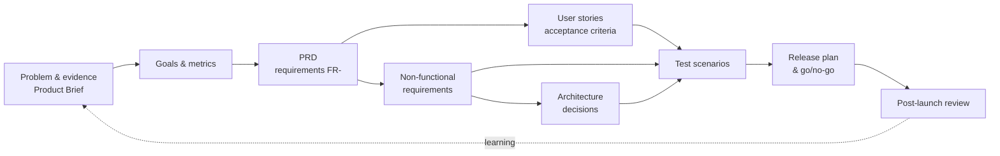

# Digital Product Planning Framework

**A practical, technology-agnostic set of templates, guides and checklists for everything you should decide *before* building a digital product.**

Most failed software projects do not fail in code. They fail in planning: an unclear problem, vague requirements, unmeasured goals, missing quality targets, an untested release plan. This framework gives individuals and teams a consistent, connected way to plan, from the first idea to a clear go/no-go decision to start development.

> **Status:** version 0.1.0 (initial release). Templates are stable enough to use; feedback is welcome. See the [changelog](CHANGELOG.md).

---

## Why this exists

- **Planning documents are usually disconnected.** A PRD says one thing, the test plan another, and nobody can tell whether every requirement is tested. Here every document shares one ID scheme, one vocabulary and explicit dependencies, so requirements, design, architecture and tests stay connected.
- **Templates are usually empty.** Each template here explains *why* it exists, *when* to write it, *who* owns it, *what you need first*, *how to fill each section*, shows a realistic example and ends with a **completion checklist**, so you know when it is good enough.
- **One size does not fit all.** A solo developer and a regulated enterprise need very different amounts of documentation. **Profiles** and **tiers** let you choose the right set and skip the rest, on purpose.
- **Technology choices should be explicit.** The framework is technology-agnostic. Specific technologies appear in exactly one document, the [Technology Stack](templates/05-architecture/technology-stack.md).

## Who should use it

- **Solo developers and founders** who want structure without bureaucracy.
- **Product managers, business analysts and project managers** coordinating cross-functional work.
- **Engineering leads and architects** who need requirements precise enough to design against.
- **QA, security, UX and operations specialists** who need to join planning early.
- **Teams building internal systems or enterprise software** that need governance and audit evidence.
- **Open-source maintainers and educators** who want a shared planning vocabulary.

## Supported product types

Web applications · Mobile applications · SaaS products · API platforms · Enterprise applications · Internal business systems · Developer tools · Other software products.

Universal templates apply to all. Optional [packages](packages/) add documents for **SaaS**, **mobile**, **API platforms**, **enterprise/internal systems** and **developer tools**; see [choosing packages](guides/choosing-packages.md).

## What is in the repository

```
.
├── README.md  CONTRIBUTING.md  CODE_OF_CONDUCT.md  LICENSE  CHANGELOG.md
├── DOCUMENTATION_GUIDE.md   how to write and maintain these documents
├── GLOSSARY.md              framework vocabulary
├── guides/                  workflow, profiles, document map, standards, traceability
├── templates/               universal templates, by domain
│   ├── 00-foundation/       manifest, glossary, decision log, readiness gate
│   ├── 01-discovery/        brief, personas, research, competitors, assumptions
│   ├── 02-strategy/         vision, goals & metrics, business model, MVP, roadmap
│   ├── 03-requirements/     PRD, NFRs, user stories, business rules, traceability
│   ├── 04-ux-ui/            IA, flows, wireframes, design system, accessibility
│   ├── 05-architecture/     overview, ADRs, data, APIs, security design, infrastructure
│   ├── 06-project-mgmt/     charter, milestones, risks, working agreements
│   ├── 07-quality/          test strategy, plans, scenarios, UAT
│   ├── 08-security/         requirements, threat model, privacy, access control
│   ├── 09-release-ops/      environments, release, deployment, operations
│   └── 10-analytics/        analytics, events, feedback, post-launch review
├── packages/                product-specific templates (saas, mobile, api-platform, enterprise, developer-tools)
├── checklists/              planning readiness and per-domain checklists
├── examples/                a fully worked, cross-referenced example product
├── scripts/                 validation and scaffolding tools (Python standard library only)
└── .github/                 issue forms, pull-request template, validation workflow
```

**71 universal templates** (10 mandatory, 44 recommended, 17 optional), **17 package templates** and a project manifest.

## How to use it

1. **Create your project's planning folder.** Either use this repository as a GitHub template, or run the scaffold script to copy only what you need:
   ```
   scripts/scaffold --profile team --types saas,mobile --out ../my-product/docs
   ```
2. **Choose a profile** ([solo, team or enterprise](guides/profiles.md)) and list your product types in the [project manifest](templates/00-foundation/project-manifest.yaml).
3. **Fill in the templates in the recommended order** ([workflow](guides/planning-workflow.md)). Start rough and work breadth-first; deepen where risk is highest. Delete the *About this template* blocks and guidance when you no longer need them (`scripts/strip-guidance`).
4. **Connect the documents with IDs** (`GOAL-01`, `FR-001`, `US-001`, `NFR-004`, `TS-020`…). See [traceability](guides/traceability.md).
5. **Validate.** Run `scripts/validate-metadata`, `scripts/check-links` and `scripts/check-traceability`.
6. **Hold the readiness gate.** Complete the [Planning Readiness Review](templates/00-foundation/planning-readiness-review.md), then start building with clear, actionable documentation.

New here? Read the [workflow](guides/planning-workflow.md), skim the [document map](guides/document-map.md), then study the [worked example](examples/slotwise/).

## The core idea: one connected chain



Every requirement traces up to a goal and down to a test; every metric traces to the data that measures it.

## Document tiers and status conventions

| Tier | Meaning |
|---|---|
| **Mandatory** | Needed for almost every product before building starts (skip only with a recorded reason) |
| **Recommended** | Strongly advised for teams and meaningful risk |
| **Optional** | Create when the template's *When to use* trigger applies |
| **Package** | Product-type-specific |

| Status | Meaning |
|---|---|
| `draft` | Being written |
| `in-review` | Ready for review |
| `approved` | Agreed; change via a new version and a decision-log entry |
| `superseded` / `archived` | Replaced / kept for history |
| `not-applicable` | Deliberately skipped (with a reason) |

Details: [naming and metadata](guides/naming-and-metadata.md).

## Principles

1. Quality, clarity and consistency over quantity of documents.
2. One fact has one home; everything else links to it.
3. Prefer measurable statements to adjectives.
4. Distinguish universal practice from context-dependent advice.
5. Never assert laws, standards or certifications as requirements; name them as examples to verify with qualified people.
6. Unknown is a valid entry, as long as it has an owner and a date.

## Important limitations

- The framework is **not legal, financial, medical or security advice**. Templates for privacy, compliance, billing, security and incident handling prompt you to find and verify obligations for your situation with qualified professionals.
- Standards and platform policies change. Where a template mentions one (accessibility standards, store policies, vendor limits), record the version and date you checked.
- Documents do not guarantee good products. They make your decisions visible, testable and discussable.

## Contributing

Contributions are welcome: new templates, improvements, examples, translations, validation tooling. Please read [CONTRIBUTING.md](CONTRIBUTING.md) and the [Code of Conduct](CODE_OF_CONDUCT.md). The best first contributions are: fixing unclear guidance, improving an example, or reporting a place where two templates disagree.

## License

Content (templates, guides, checklists, examples, documentation) is licensed under **[Creative Commons Attribution 4.0 International (CC BY 4.0)](https://creativecommons.org/licenses/by/4.0/)**. Scripts are licensed under the **MIT License**. See [LICENSE](LICENSE). You may use the templates in your own commercial or private projects; the documents *you create* from them are yours.

## Acknowledgements

See [ACKNOWLEDGEMENTS.md](ACKNOWLEDGEMENTS.md).
