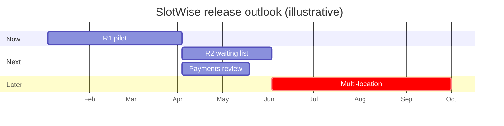

# Product Roadmap: SlotWise

## 1. Strategic Themes

| Theme | Outcome sought | Goal / metric |
|---|---|---|
| Reliable bookings | Fewer no-shows and no double bookings | GOAL-01 / MET-01 |
| Online by default | Customers book from a link instead of calling | GOAL-02 / MET-02 |
| Sustainable business | Paying salons cover delivery cost | GOAL-02 / MET-03 |

## 2. Roadmap (Now / Next / Later)

| Horizon | Theme | Outcome / problem to solve | Candidate scope (IDs) | Confidence | Release |
|---|---|---|---|---|---|
| **Now** (0–3 months) | Reliable bookings | Customers self-book, get a confirmation and a reminder, and cancel before cutoff | FR-001, FR-002, FR-003 | High | R1 |
| **Now** (0–3 months) | Online by default | Owners publish real availability and measure attendance | FR-004, FR-005 | High | R1 |
| **Next** (3–6 months) | Reliable bookings | A freed slot is offered to waiting customers | FR-006, DEC-003 | Medium | R2 |
| **Next** (3–6 months) | Sustainable business | Revisit deposits once pilot pricing is validated | C-03, DEC-001 | Medium | R2 evaluation |
| **Later** (6+ months) | Expansion | Multi-location salons and marketplace discovery | Not scoped | Low | Not committed |

## 3. Dependencies and Constraints

| Item | Affects | Owner | Date needed |
|---|---|---|---|
| DEP-01 email/SMS provider per ADR-0002 | FR-002 reminders and MET-01 | engineering-lead | 2026-12-15 |
| CON-01, 2 engineers, 1 designer, 14 weeks | All R1 scope, RISK-04 | project-manager | Fixed for R1 |
| DEC-003, waiting list deferred | FR-006 and R2 scope | product-manager | Decided 2026-10-20 |
| Q-001 reminder timing result | Reminder schedule in FR-002 | product | Pilot week 6 |
| MET-01 and MET-02 90 day review | Next release scope | product-manager | 2027-04-04 |

## 4. What We Are Not Doing

Payments are out of R1 per DEC-001 because pilot owners already take payment in person. Marketplace discovery and multi-location chains are PRD non-goals. A native mobile app is not planned; customers use a phone browser and owners use a responsive web calendar.

## 5. Change Log and Decisions

| Date | Change | Reason | DEC- |
|---|---|---|---|
| 2026-11-27 | Waiting list placed in R2, payments removed from R1 | CON-01 capacity and DEC-001 | DEC-003 |
| 2026-11-27 | Reminder timing tied to pilot week 6 review | Q-001 open, RISK-01 | No decision yet |

## 6. Communication

The team sees the full roadmap in a weekly planning session. Leadership gets a monthly summary of themes and confidence. Pilot salons see only the R1 scope and rollout dates from the [Release Plan](../09-release-ops/release-plan.md). "Now" is a commitment, "Next" is a direction, and "Later" is an idea, not a promise.

## Completion Criteria

- [x] Items are outcomes or problems with linked goals, not just feature names.
- [x] Horizons show decreasing confidence; dates are only committed for the near term.
- [x] Scope IDs match the PRD and prioritization decisions.
- [x] Dependencies and exclusions are visible.
- [x] A review cadence and change log exist.
