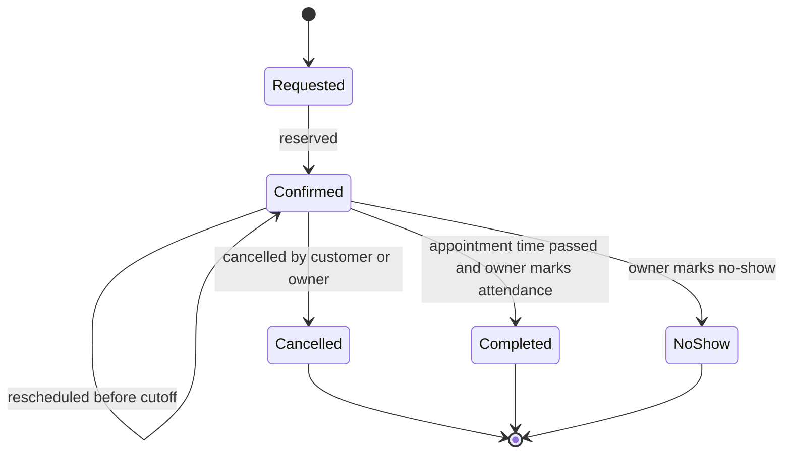

# Business Rules: SlotWise

## 1. Rule Catalog

| ID | Type | Rule statement | Applies to | Source / owner | Exceptions | Requirements | Status |
|---|---|---|---|---|---|---|---|
| BR-001 | Constraint | A booking must fall inside the salon's published availability for the chosen service | Booking | Product policy / PM | Owner may override manually for a phone booking | FR-001, FR-004 | Approved |
| BR-002 | Constraint | A slot may be reserved by at most one active booking | Booking | ADR-0001 / engineering lead | None | FR-001 | Approved |
| BR-003 | Derivation | Booking end time = start time + service duration + buffer | Booking | Owner setting / PM | Buffer may be 0 | FR-001, FR-004 | Approved |
| BR-004 | Inference | If a customer cancels after the salon cutoff, the cancellation is refused and the salon phone number is shown | Cancellation | FR-003, AC-003.2 / PM | Owner may cancel manually at any time | FR-003 | Approved |
| BR-005 | Authorization | Only the salon owner may edit availability and mark appointment status in R1 | Availability, appointment status | PRD FR-004 and FR-005 / PM | No staff accounts in R1 | FR-004, FR-005 | Approved |
| BR-006 | Constraint | A confirmation is sent within 1 minute of creation and at most one reminder is sent 24 hours before the start | Messaging | AC-002.1 to AC-002.3 / PM | Cancelled bookings send no reminder | FR-002 | Approved |

## 2. Decision Tables (for rules with combinations)

| Condition: cancellation timing | Condition: booking status | Outcome |
|---|---|---|
| At or before the cutoff | Confirmed | Cancel immediately, slot freed (AC-003.1) |
| After the cutoff | Confirmed | Refuse cancel, show salon phone number (AC-003.2) |
| Any timing | Cancelled | No reminder sent (AC-002.3) |

Deposits are not part of these outcomes because DEC-001 keeps payments out of R1.

## 3. State Rules

## 4. Regulatory and Policy Obligations

| ID | Obligation | Authoritative source | Reviewed by / date | Rules affected |
|---|---|---|---|---|
| NFR-004 | Customer contact data is used only for booking messages and deleted on request within 30 days | [Non-Functional Requirements](non-functional-requirements.md) NFR-004 and product privacy policy | product-manager, 2026-11-27 | BR-006 |

## 5. Rule Changes

| Date | Rule | Change | Reason | DEC- |
|---|---|---|---|---|
| 2026-11-27 | BR-004 | Removed deposit refund logic, cancellation is now gated by the salon cutoff | DEC-001 keeps payments out of R1 | DEC-001 |
| 2026-11-27 | BR-006 | Added confirmation and single-reminder timing rule | AC-002.1 to AC-002.3 need one canonical statement | No separate decision |

## Completion Criteria

- [x] Each rule is atomic, declarative and has an ID, source and owner.
- [x] Rules with multiple conditions use a decision table or state diagram.
- [x] Stories and tests reference rules by ID; rules are not restated elsewhere.
- [x] Regulatory obligations cite an authoritative source and reviewer.
- [x] No two rules conflict; conflicts are resolved and recorded.
