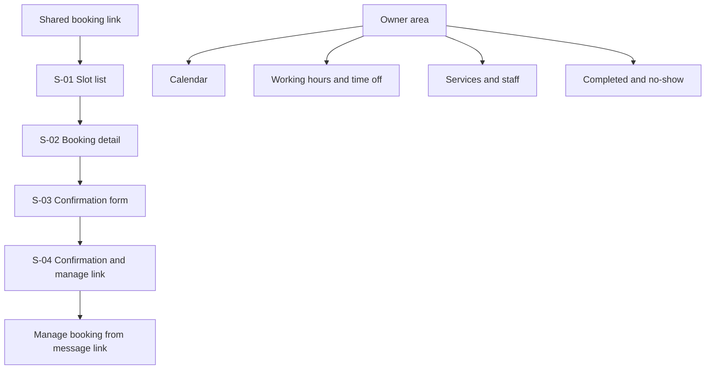

# Information Architecture and Sitemap: SlotWise

## 1. Content and Function Inventory

| ID | Item | Type (content / function) | Source requirement | Audience | Frequency of use |
|---|---|---|---|---|---|
| I-01 | Service list | Content | FR-001 | Customer (PER-02) | High |
| I-02 | Slot picker with date and time | Function | FR-001 | Customer (PER-02) | High |
| I-03 | Booking details form | Function | FR-001 | Customer (PER-02) | High |
| I-04 | Confirmation screen and manage link | Content | FR-002, FR-003 | Customer (PER-02) | High |
| I-05 | Working hours and time off | Function | FR-004 | Owner (PER-01) | Medium |
| I-06 | Services and staff list | Function | FR-004 | Owner (PER-01) | Medium |
| I-07 | Completed and no-show marking | Function | FR-005 | Owner (PER-01) | Medium |
| I-08 | Confirmation and reminder message text | Content | FR-002 | Customer (PER-02) | Low |

## 2. Grouping and Labelling

| Group | Contains | Label users use | Label we use | Evidence |
|---|---|---|---|---|
| Booking | I-01, I-02, I-03, I-04 | "Book a time" | Book | PRD FR-001 wording and persona context |
| Salon setup | I-05, I-06 | "My hours and staff" | Salon setup | PRD FR-004 wording |
| Attendance | I-07 | "Who turned up" | Attendance | PRD FR-005 and glossary term No-show |

**Labelling rules:** plain language, one term per concept (recorded in the [Glossary](../00-foundation/glossary.md)), verbs for actions, nouns for places. Slot is shown as "time" in customer copy but keeps the name Slot in documents.

## 3. Sitemap

| Page / screen ID | Name | Parent | Audience | Requirement | Access |
|---|---|---|---|---|---|
| S-01 | Slot list | Shared booking link | Customer (PER-02) | FR-001 | Public |
| S-02 | Booking detail | S-01 | Customer (PER-02) | FR-001 | Public |
| S-03 | Booking confirmation form | S-02 | Customer (PER-02) | FR-001 | Public |
| S-04 | Confirmation and manage link | S-03 | Customer (PER-02) | FR-002, FR-003 | Public with manage token |
| Owner area | Calendar, hours, staff, attendance | Owner sign-in | Owner (PER-01) | FR-004, FR-005 | Authenticated owner |

## 4. Navigation Model

| Element | Content | Behaviour | Notes |
|---|---|---|---|
| Primary navigation | Slot list, detail, confirmation form | Forward and back between S-01 and S-04; the prototype exposes these as screen buttons | No account menu for guests (DEC-002) |
| Secondary / local | Date and service filters on S-01 | Filters narrow the slot list in place | No separate filter page |
| Utility (account, help) | Manage booking link in the confirmation or reminder message | Opens the manage view with a signed token | Salon phone number is shown when the cutoff has passed (FR-003) |
| Search and filters | Service select and date select | Required before slot lookup; service select has an empty first option | Exact date formats are [OPEN: designer, 2026-12-15] |
| Breadcrumbs / back behaviour | Back to slot list | Preserves chosen service and date; never loses entered form data | Browser back is handled the same way |

## 5. Naming, URLs and Deep Links

Booking pages use readable nouns and no account identifiers: `/book` for S-01, `/book/slots/{slot}` for S-02, `/book/confirm/{slot}` for S-03, and `/book/confirmed/{booking}` for S-04. The manage link uses a signed token in the path. Unknown routes show the slot list with a plain message and a link to `/book`. The public host name and slug rules are [OPEN: owner, 2026-12-15].

## 6. Validation

| Test | Result | Change made |
|---|---|---|
| Click-through of S-01 to S-04 in the prototype on 2026-11-27 | All four screens reachable by button and keyboard | None |
| Tree test: "Find where to change opening hours" with PER-01 | [OPEN: designer, 2026-12-15] | [OPEN: designer, 2026-12-15] |
| Review of customer labels with PER-02 | [OPEN: designer, 2026-12-15] | [OPEN: designer, 2026-12-15] |

## Completion Criteria

- [x] Every in-scope FR maps to at least one screen or content item.
- [x] Groupings and labels use PRD wording and the glossary term for Slot.
- [x] Sitemap shows all screens with access level; no orphan pages.
- [x] Core booking task is reachable in four screens, with manage access from the message link.
- [x] Navigation model covers primary, secondary and utility navigation and the unknown-route case.
- [ ] Tree test and customer label review are scheduled with named participants.
