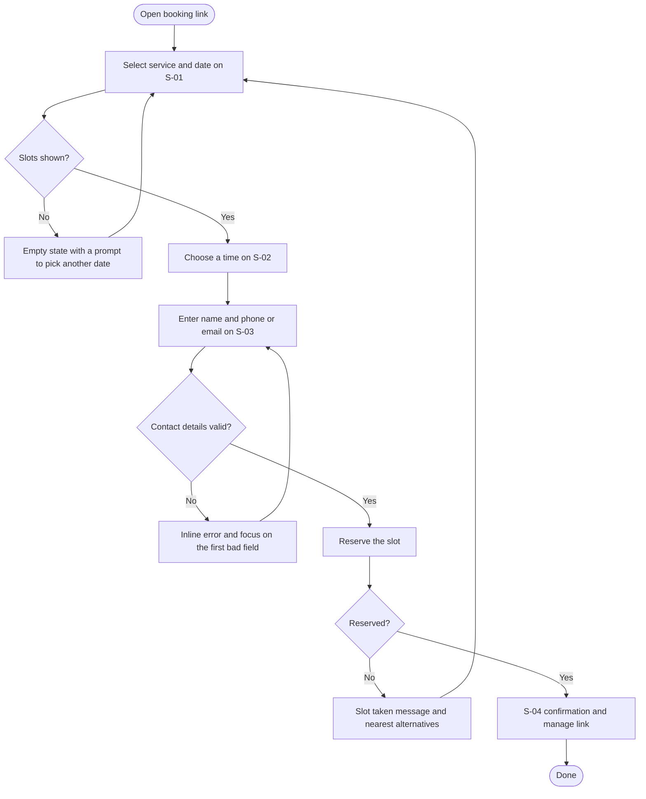
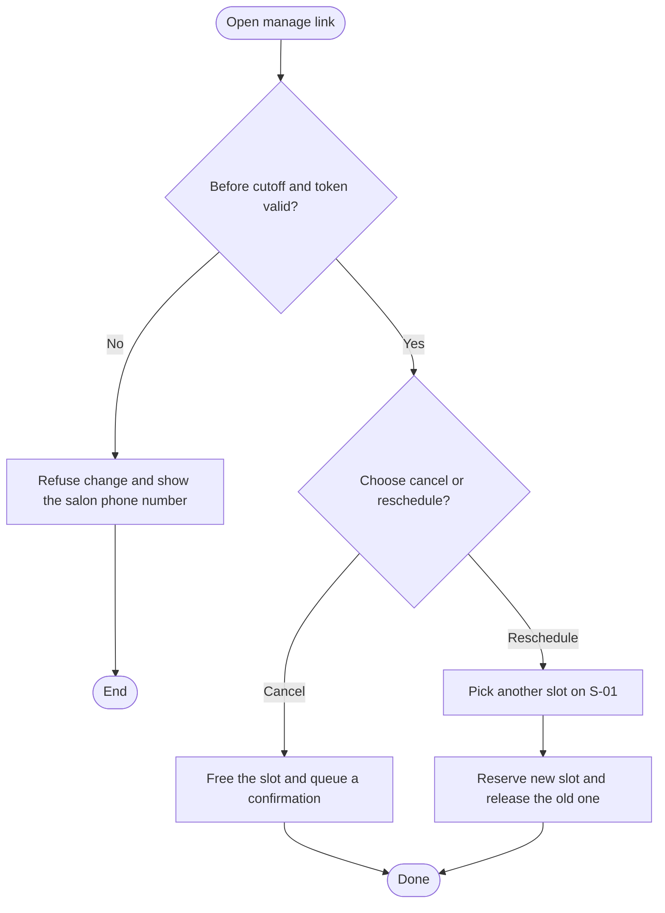
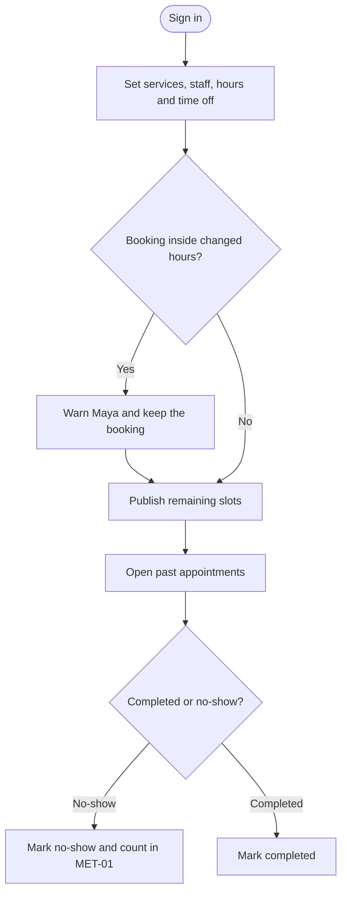

# User Flows: SlotWise

## 1. Flow Index

| ID | Flow | Persona | Goal | Entry point | Requirements | Priority |
|---|---|---|---|---|---|---|
| UF-01 | Customer books a slot without an account | PER-02 (Dani) | Confirmed booking and a manage link | Shared booking link | FR-001, FR-002 | Must |
| UF-02 | Customer cancels or reschedules from a message link | PER-02 (Dani) | Slot freed or moved before the cutoff | Confirmation or reminder message | FR-003 | Must |
| UF-03 | Owner sets availability and records attendance | PER-01 (Maya) | Published slots and a correct no-show count | Owner sign-in | FR-004, FR-005 | Must |

## 2. Flow Detail

### UF-01: Customer books a slot without an account

**Trigger and context:** Dani opens the salon's booking link on a phone and picks a service. **Success state:** S-04 shows the confirmed booking, and a confirmation message is queued. **Primary failure states:** no slots for the date, invalid contact details, slot taken by another customer, network loss.

| Step | Screen / state | User action | System response | Error / alternative | Event |
|---|---|---|---|---|---|
| 1 | S-01 Slot list | Select a service and date | Show slots inside published hours, excluding booked times and time off | No slots: "Belum ada slot tersedia untuk tanggal ini. Pilih tanggal lain." | EVT-001 on service select |
| 2 | S-02 Booking detail | Choose a time and continue | Show service, date, time and staff as a summary | Slot taken: "Slot baru saja diambil. Pilih waktu terdekat." | None |
| 3 | S-03 Confirmation form | Enter name and phone or email, then confirm | Validate contact details and reserve in one transaction (ADR-0001, BR-002) | Invalid input: inline error beside the field | None |
| 4 | S-04 Confirmation | Read confirmation and keep the manage link | Queue confirmation, then one reminder (FR-002) | Queue failure is retried by the worker (ADR-0002) | EVT-002 on server confirmation |

**Edge cases:** browser back during the form keeps entered data; two tabs confirming the same slot resolve through the uniqueness rule in ADR-0001; slow connection shows a loading message before the list appears; the full flow works with keyboard only under NFR-005.

### UF-02: Customer cancels or reschedules from a message link

**Trigger and context:** Dani opens the link in a confirmation or reminder message. **Success state:** the slot is freed and a cancellation confirmation is queued. **Primary failure states:** cutoff passed, token expired, booking already cancelled.

| Step | Screen / state | User action | System response | Error / alternative | Event |
|---|---|---|---|---|---|
| 1 | Manage link | Open link from message | Check token and cutoff | After cutoff: show salon phone number (AC-003.2) | None |
| 2 | Manage view | Choose cancel | Free the slot immediately (AC-003.1) | Already cancelled: show current state | None |
| 3 | S-01 Slot list | Choose a replacement time | Reserve new slot, release old slot | Taken slot: nearest alternatives | EVT-001 on service select |

**Edge cases:** the cutoff value is an owner setting and its default is [OPEN: owner, 2026-12-15]; the manage link is single-purpose and never exposes another customer's booking.

### UF-03: Owner sets availability and records attendance

**Trigger and context:** Maya signs in between clients on her phone. **Success state:** only real slots are published, and a no-show counts toward MET-01. **Primary failure states:** hours changed over an existing booking, duplicate staff entry, sign-in failure.

| Step | Screen / state | User action | System response | Error / alternative | Event |
|---|---|---|---|---|---|
| 1 | Owner area | Edit hours, time off and staff | Recompute offered slots (BR-001, AC-004.1) | Conflict with a booking: warn, keep booking (AC-004.2) | None |
| 2 | Owner area | Mark an appointment no-show | Set status and count in MET-01 (AC-005.1) | Wrong status: owner can correct it before the daily cut | None |

**Edge cases:** sign-in failure is handled on the owner flow only, since customers never sign in (DEC-002); support access follows the audited path in [Authentication & Authorization](../05-architecture/authentication-authorization.md).

## 3. Cross-Flow Concerns

| Concern | Decision |
|---|---|
| Authentication moments | Customers stay guests and use a signed manage link; only the owner signs in with an account. |
| Error recovery pattern | Name the failure in text, keep entered data, and offer one next action. See the [Design System](design-system.md). |
| Empty, loading, offline states | Slot list shows the three states with the copy catalogued in the [Wireframe Spec](wireframe-spec.md). |
| Notifications and re-entry | Confirmation and reminder messages carry the manage link; the worker retries delivery under ADR-0002. |

## 4. Coverage Check

| Requirement | Has a flow? | Has error paths? | Notes |
|---|---|---|---|
| FR-001 | Yes, UF-01 | Yes | Slot taken and invalid contact details |
| FR-002 | Yes, UF-01 | Yes | Confirmation queued, worker retries on failure |
| FR-003 | Yes, UF-02 | Yes | Cutoff and expired token |
| FR-004 | Yes, UF-03 | Yes | Hours conflict with an existing booking |
| FR-005 | Yes, UF-03 | Yes | Incorrect attendance status can be corrected |

Waiting list work is held for R2 and has no flow in this set.

## Completion Criteria

- [x] Each Must FR with user interaction is covered by a flow.
- [x] Every flow shows entry, success, and at least one failure path.
- [x] Decisions and system responses use PRD acceptance criteria and BR-001 or BR-002.
- [x] Steps reference screen IDs from S-01 to S-04 and the events defined in the event tracking plan.
- [x] Edge cases cover interruptions, errors, two tabs and keyboard-only use.
