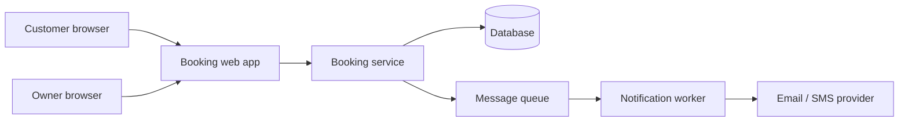

# Architecture Overview: SlotWise

## Context

## Building blocks

| Block | Responsibility | Requirements served |
|---|---|---|
| Booking web app | Booking page and owner calendar | FR-001, FR-004 |
| Booking service | Availability, booking rules, cancellation | FR-001, FR-003, FR-005, NFR-001, NFR-003 |
| Notification worker | Confirmations and reminders, retries | FR-002 |
| Database | Salons, services, staff, bookings | NFR-003, NFR-004 |

Specific technologies are recorded only in the Technology Stack document (not part of this solo-sized example).

## Decisions

### ADR-0001: One database transaction guards each slot

- **Status:** accepted
- **Context:** NFR-003 requires no double bookings; two customers may confirm the same slot at once.
- **Decision:** Booking creation checks and reserves the slot in a single transaction with a uniqueness rule on staff and start time.
- **Consequences:** Simple and correct; the loser of a race gets alternatives (AC-001.2). Limits scale-out of writes, acceptable at pilot volume.

### ADR-0002: Reminders go through a queue and an external delivery provider

- **Status:** accepted
- **Context:** FR-002 needs reliable delivery; DEP-01 is the provider.
- **Decision:** The booking service enqueues messages; a worker sends them with retries and records the result.
- **Consequences:** Delivery failures do not block booking. Provider choice is revisited if cost per message exceeds plan.

## Completion Criteria

- [x] Context and building blocks traced to requirements
- [x] Significant decisions recorded as ADRs
