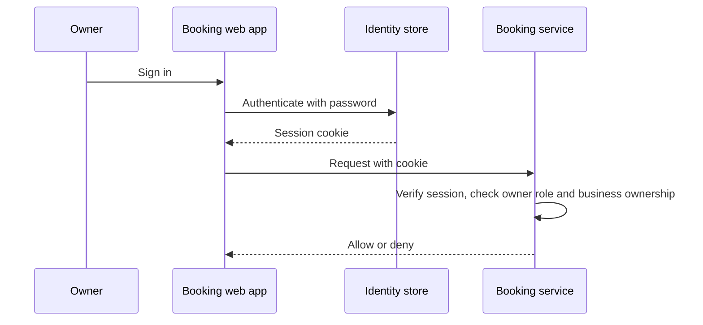

# Authentication and Authorization Design: SlotWise

## 1. Actors and Identity Types

| Actor | Type (human / service / device) | Identity source | Notes |
|---|---|---|---|
| Customer (guest) | Human, unauthenticated | Signed manage token sent in the confirmation or reminder message | Books without an account (DEC-002, ADR-0003) |
| Business owner (PER-01) | Human | Owner account in the identity store | Signs in to manage services, staff, hours and attendance |
| Support agent | Human, internal | Corporate identity | Read-only access with audit trail |
| Notification worker | Service | Service credential for the queue and provider | Sends messages only, never changes bookings |
| Partner system | Service | Out of R1 | No partner API in this release |

## 2. Authentication

| Topic | Decision |
|---|---|
| Methods supported | Owner account with password and reset link; guest manage token in the message; service credential for the worker |
| Credential policy | Minimum length 12 characters for owner passwords, with breach check and throttling; exact thresholds are [OPEN: security-lead, 2026-12-15] |
| Multi-factor | [OPEN: security-lead, 2026-12-15] before pilot; not assumed to be enabled for owners |
| Account lifecycle | Owner registers when the salon is created, verifies email, can reset a password, and can be deactivated by support; deletion policy is [OPEN: owner, 2026-12-15] |
| Session management | Secure, HttpOnly cookies with renewal on use; lifetime and revocation list are [OPEN: security-lead, 2026-12-15] |
| Service-to-service | Worker authenticates to the queue with a managed credential; rotation policy is [OPEN: engineering-lead, 2026-12-15] |
| Secrets management | Secrets live in a managed secret store, never in source control or documents; rotation every 90 days per SR-004 |
| Guest tokens | Signed, scoped to one booking, valid only for cancel or reschedule before the cutoff (ADR-0003, ADR-0004) |

## 3. Authorization Model

| Topic | Decision |
|---|---|
| Model | Combination of role-based checks and business ownership, decided in ADR-0005 |
| Roles and permissions | Owner manages their own business; support reads with audit; worker sends messages; guest uses a scoped token. Full detail is in the [Access Control Matrix](../08-security/access-control-matrix.md). |
| Tenant / data boundary rules | Every booking, slot, service and staff record carries the business identifier; a query without that scope is denied. See [Multi-Tenancy and Isolation](../packages/saas/multi-tenancy-and-isolation.md). |
| Enforcement points | Booking service and data queries check role and ownership; default deny. Edge checks are not sufficient (ADR-0005). |
| Delegation and impersonation | Support access needs approval, a time limit and an audit entry; owner is [OPEN: security-lead, 2026-12-15] |
| Privileged operations | Changing hours over an existing booking and viewing customer contact details require the owner role and are logged |

## 4. Flows

Guest path: Dani opens the manage link from a message, the service verifies the signed token and the cutoff, then allows cancel or reschedule for that booking only (ADR-0003, ADR-0004). Worker path: the notification worker reads queued messages with its service credential and calls the provider; it never reads the booking database for authorization decisions. Registration, recovery, token renewal, revocation and support access paths are [OPEN: security-lead, 2026-12-15].

## 5. Auditing and Monitoring

Log owner sign-in success and failure, password reset, permission change, support access and staff viewing of customer contact details. Keep timestamps and actor identifiers, mask tokens in logs, and review access events weekly. Retention and alert rules are in the [Observability Strategy](../09-release-ops/observability-strategy.md), with exact retention [OPEN: security-lead, 2026-12-15].

## 6. Threats and Mitigations

| Threat | Mitigation | Verified by |
|---|---|---|
| Credential stuffing against the owner account | Throttling, breach check, MFA decision under ADR-0005 review | Security test with owner [OPEN: security-lead, 2026-12-15] |
| Privilege escalation or insecure direct object access | Business ownership check in service and queries, default deny (ADR-0005) | Cross-business security test with owner [OPEN: security-lead, 2026-12-15] |
| Token theft from a forwarded message | Scoped to one booking, expiry, cutoff check, no history exposure (ADR-0003) | TS-004 and security test with owner [OPEN: security-lead, 2026-12-15] |
| Customer data exposure beyond need | TS-006 checks deletion; access is logged | TS-006 |

## 7. Open Decisions

| ID | Decision | Owner | ADR |
|---|---|---|---|
| AUTH-01 | Whether owners require multi-factor authentication before pilot | Security lead | ADR-0005 |
| AUTH-02 | Session lifetime and revocation rules | Security lead | ADR-0005 |
| AUTH-03 | Guest token lifetime and rotation | Engineering lead | ADR-0003 |

AUTH-01 to AUTH-03 are tracking labels local to this document; each has an owner and a linked ADR.

## Completion Criteria

- [x] Every actor and identity type is identified, including services and support staff.
- [x] Authentication, session, recovery and secrets handling are defined, with open values named.
- [x] Authorization model, enforcement points and default-deny behaviour are stated.
- [x] Business ownership isolation is explicit and linked to the SaaS package.
- [ ] Auditing and key threat mitigations are complete, and a qualified reviewer has checked the design.
- [x] Choices are recorded as ADRs and cite named standards and versions where applicable.
