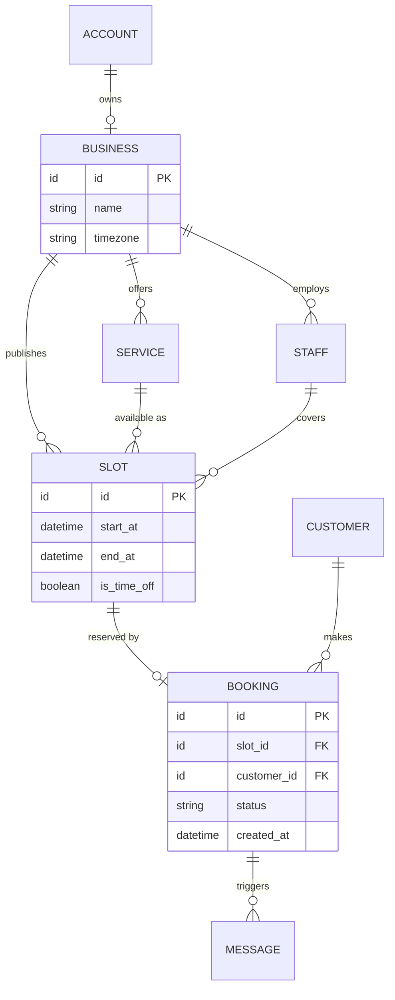

# Data Model: SlotWise

## 1. Conceptual Model (ERD)

| Entity | Definition (business language) | Owner / source of truth | Lifecycle |
|---|---|---|---|
| Business | The salon that publishes services and owns bookings | Owner account | Created at sign-up, retained while the salon uses SlotWise |
| Account | Sign-in identity of the owner | Identity store | Active or deactivated |
| Service | A bookable salon service with a duration and buffer | Owner | Active or retired |
| Staff | A person whose time can be booked | Owner | Active or retired |
| Slot | One open time period for a service and staff member | Booking service, derived from hours and time off | Published, then reserved or expired |
| Booking | A customer's reservation of one slot | Booking service | Requested, confirmed, then completed, cancelled or no-show |
| Customer | Contact details for one customer of a business | Booking service | Kept until retention or deletion request |
| Message | A confirmation, reminder or cancellation message | Notification worker | Queued, sent, failed or retried |

## 2. Relationships and Constraints

| Relationship | Cardinality | Rule | Business rule ID |
|---|---|---|---|
| Slot to Booking | 1 : 0..1 | A slot has at most one active booking | BR-002 |
| Service to Slot | 1 : many | A slot belongs to one service inside published hours | BR-001 |
| Slot duration | Derived | End time is start time plus service duration plus buffer | BR-003 |
| Account to Business | 1 : 0..1 | One owner account manages one business in R1 | ADR-0005 |
| Business to every other entity | 1 : many | Every record carries the business identifier and is scoped by it | ADR-0005 |

## 3. Data Dictionary

| Entity | Field | Type (logical) | Required | Constraints / allowed values | Description | Classification | PII? | Source / rule |
|---|---|---|---|---|---|---|---|---|
| Business | id | Identifier | Yes | Unique, immutable, non-sequential | Salon identifier | Internal | No | Generated |
| Business | name | Text | Yes | 1 to 120 characters | Salon name shown in messages | Public | No | Owner input |
| Business | timezone | Text | Yes | IANA time zone name | Local hours for the cutoff and slots | Internal | No | Owner input, ADR-0004 |
| Account | id | Identifier | Yes | Unique, immutable | Owner identity | Internal | No | Identity store |
| Account | email | Text | Yes | Valid email format | Sign-in and reset address | Confidential | Yes | Owner input |
| Service | id | Identifier | Yes | Unique per business | Service identifier | Internal | No | Generated |
| Service | name | Text | Yes | 1 to 80 characters | Customer-facing label | Public | No | Owner input, FR-004 |
| Service | duration_min | Integer | Yes | Positive | Length of the service | Internal | No | Owner input, BR-003 |
| Service | buffer_min | Integer | Yes | Zero or positive | Gap after the service | Internal | No | Owner input, BR-003 |
| Staff | id | Identifier | Yes | Unique per business | Staff identifier | Internal | No | Generated |
| Staff | name | Text | Yes | 1 to 80 characters | Label shown in booking detail | Confidential | Yes | Owner input |
| Slot | id | Identifier | Yes | Unique, non-sequential | Slot identifier used in links | Internal | No | Generated |
| Slot | start_at | Datetime | Yes | UTC, inside published hours | Start of the open time | Internal | No | Owner hours, time off, BR-001 |
| Slot | end_at | Datetime | Yes | After start_at | End of the open time | Internal | No | BR-003 |
| Slot | is_time_off | Boolean | Yes | Default false | Marks owner time off | Internal | No | Owner input, AC-004.1 |
| Booking | id | Identifier | Yes | Unique, immutable | Booking identifier | Internal | No | Generated |
| Booking | slot_id | Identifier | Yes | Foreign key to Slot | Reserved slot | Internal | No | ADR-0001 |
| Booking | customer_id | Identifier | Yes | Foreign key to Customer | Customer on the booking | Internal | No | Generated |
| Booking | status | Enumeration | Yes | confirmed, cancelled, completed, no_show | Current state | Internal | No | AC-005.1, state rules in business rules |
| Booking | manage_token_hash | Text | Yes | Hash of signed token, never the raw token | Validates manage requests | Confidential | No | ADR-0003 |
| Booking | created_at | Datetime | Yes | UTC | Creation time | Internal | No | Generated |
| Customer | id | Identifier | Yes | Unique per business | Customer identifier | Internal | No | Generated |
| Customer | name | Text | Yes | 1 to 80 characters | Name shown to the salon | Confidential | Yes | Guest input, AC-001.3 |
| Customer | phone | Text | Yes | Valid format | Delivery channel for messages | Confidential | Yes | Guest input, BR-006, NFR-004 |
| Customer | email | Text | No | Valid email format | Alternative delivery channel | Confidential | Yes | Guest input, BR-006 |
| Message | id | Identifier | Yes | Unique, immutable | Message identifier | Internal | No | Generated |
| Message | booking_id | Identifier | Yes | Foreign key to Booking | Booking that triggered the message | Internal | No | Generated |
| Message | channel | Enumeration | Yes | email, sms | Delivery channel | Internal | No | Provider choice in ADR-0002 |
| Message | status | Enumeration | Yes | queued, sent, failed | Delivery state | Internal | No | Worker result, ADR-0002 |

Use logical types as shown. Physical types are chosen during implementation and must match the Technology Stack document.

## 4. Physical Design Notes

| Topic | Decision |
|---|---|
| Storage technology and rationale | Managed relational store chosen in [Technology Stack](technology-stack.md), because ADR-0001 needs one transaction and a uniqueness rule |
| Keys and indexes | Unique index on `(staff_id, start_at)` for active bookings, index on `(business_id, start_at)` for slot lookup, foreign keys on all ids |
| Partitioning / tenancy approach | Every table carries `business_id`; queries filter by it, and cross-business reads are denied (ADR-0005) |
| Naming conventions | snake_case fields, plural table names, UTC timestamps |
| Migration and versioning approach | Versioned forward migrations in source control; rollback is a new forward migration, never an in-place edit |

## 5. Data Lifecycle

| Data set | Retention | Archival / deletion | Backup | Legal or policy basis |
|---|---|---|---|---|
| Bookings and customer contact details | 90 days after the appointment per privacy requirements | Delete on customer request within 30 days (NFR-004) | Daily backups, restore tested per [Backup & Recovery](../09-release-ops/backup-and-recovery.md) | PD-01 and PD-02 in Privacy Requirements |
| Messages | [OPEN: owner, 2026-12-15] | [OPEN: owner, 2026-12-15] | Included with the data store backup | [OPEN: owner, 2026-12-15] |
| Analytics events | Pseudonymous only, kept 12 months | Aggregated after retention | Not part of the booking store | PD-03 in Privacy Requirements |

## 6. Data Quality and Integrity

The booking service validates all external input before writes (BR-001, BR-006). Referential integrity is enforced by foreign keys, and the uniqueness rule enforces BR-002. Customer duplicates are matched on phone or email within one business, never across businesses. Message delivery results are reconciled with the provider on a schedule that is [OPEN: engineering-lead, 2026-12-15]. Changes to bookings and availability are audited with actor and timestamp.

## 7. Reference and Seed Data

Service names, durations, buffers, staff names, working hours, time off and the cancellation cutoff are owner inputs, not static seed lists. The only defaults are empty working hours and an empty service list at salon creation. Test fixtures must use labelled placeholder values. [OPEN: owner, 2026-12-15] for any pilot seed data.

## Completion Criteria

- [x] Every entity in the PRD, business rules and API appears in the ERD, and vice versa.
- [x] Relationships and cardinalities reflect business rules, referenced by ID.
- [x] Every field has a definition, constraint, classification and PII flag.
- [ ] Retention, deletion and backup are defined for each data set; message retention is open.
- [x] Migration approach is described; no technology detail contradicts the Technology Stack.
- [x] Terms match the glossary.
