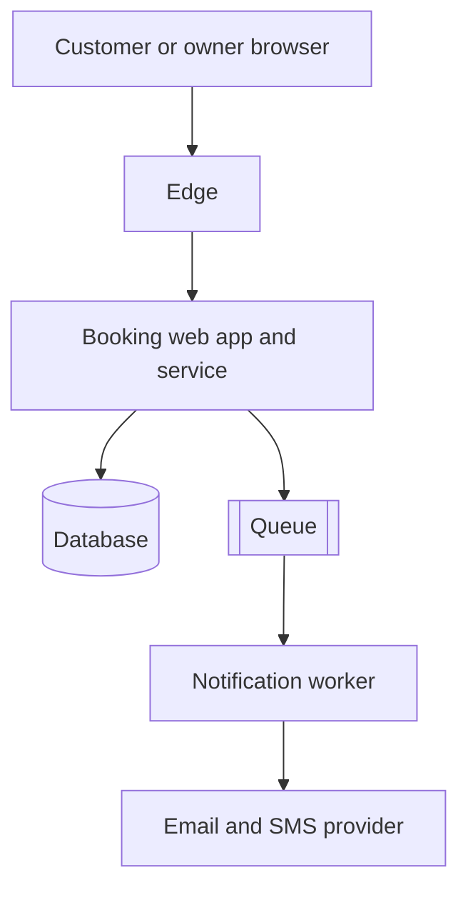

# Infrastructure and Scalability Strategy: SlotWise

## 1. Infrastructure Requirements

| Need | Requirement | Source |
|---|---|---|
| Availability | 99.5% monthly uptime during salon hours | NFR-002, verified by TS-010 |
| Slot lookup speed | p95 under 800 ms at 50 concurrent users | NFR-001, verified by TS-005 |
| Data integrity | Zero double bookings in 1,000 concurrent attempts | NFR-003, verified by TS-002 |
| Privacy | Customer data deletable within 30 days | NFR-004, verified by TS-006 |
| Accessibility | Booking flow usable by keyboard and screen reader | NFR-005, verified by TS-007 |
| Recovery | RPO and RTO targets are [OPEN: owner, 2026-12-15] | [OPEN: owner, 2026-12-15] |
| Capacity | Peak booking rate is [OPEN: owner, 2026-12-15] from pilot data; growth assumption is [OPEN: owner, 2026-12-15] | Pilot measurement |
| Data residency / location constraints | [OPEN: owner, 2026-12-15] | [OPEN: owner, 2026-12-15] |
| Budget ceiling | [OPEN: owner, 2026-12-15] per month | Finance review |

## 2. Hosting and Topology

| Topic | Decision |
|---|---|
| Hosting model | Managed platform for the booking web app, booking service, queue and worker; exact provider is [OPEN: engineering-lead, 2026-12-15] |
| Regions / zones | Single region with redundant instances; zone policy is [OPEN: engineering-lead, 2026-12-15] |
| Network boundaries | Public edge for the booking page, private services for the booking service and worker, private data tier; owner sign-in uses the same edge |
| Environments | See [Environment Strategy](../09-release-ops/environment-strategy.md) |
| Stateful vs stateless | Booking web app, service and worker are stateless; the database holds booking state and the queue holds messages (ADR-0002) |
| Edge and caching | Static assets served from the edge; slot responses are not cached because availability changes per booking |
| Infrastructure as code and configuration | Environments are defined in versioned configuration; the repository path is [OPEN: engineering-lead, 2026-12-15] |

## 3. Capacity Model

| Resource | Current assumption | Per-user / per-tenant cost driver | Headroom target | Scale trigger |
|---|---|---|---|---|
| Application compute | 50 concurrent users for slot lookup (NFR-001) | Concurrent slot lookups and booking writes | [OPEN: engineering-lead, 2026-12-15] | p95 slot lookup exceeds 800 ms (NFR-001) |
| Data store | One primary store with a uniqueness rule (ADR-0001) | Slots and bookings per salon | [OPEN: engineering-lead, 2026-12-15] | Write contention or p95 lookup above target |
| Queue / workers | Messages for confirmation and reminder (ADR-0002) | Messages per booking | [OPEN: engineering-lead, 2026-12-15] | Queue age above [OPEN: engineering-lead, 2026-12-15] |
| Third-party quotas | One email and SMS provider (DEP-01) | Messages per salon | [OPEN: engineering-lead, 2026-12-15] | Provider limit alert threshold is [OPEN: engineering-lead, 2026-12-15] |

## 4. Scalability Strategy

| Stage | Expected load | Approach | Trigger to move on | Estimated effort |
|---|---|---|---|---|
| Launch | Pilot salons, load defined by TS-005 and TS-002 | One deployable booking service, managed data store, queue and worker | NFR-001 or NFR-003 breached | [OPEN: engineering-lead, 2026-12-15] |
| Growth | Higher concurrency after pilot | Scale stateless instances horizontally; add read scaling for slot lookup if needed | Sustained p95 above 800 ms or write contention | [OPEN: engineering-lead, 2026-12-15] |
| Later | Demand beyond the pilot design | Revisit write path and tenancy layout with a measured plan | Growth stage limits reached | [OPEN: engineering-lead, 2026-12-15] |

**Known bottlenecks and plan:** the single transactional write path that guards slots (ADR-0001) is the first limit; measured contention comes before any redesign. **What we will not do yet, and why:** no multi-location management and no waiting list, because the 14-week plan protects R1 scope (CON-01).

## 5. Resilience

| Failure | Design response | Target |
|---|---|---|
| Instance loss | Redundant stateless instances with automatic replacement | No customer-visible outage during salon hours (NFR-002) |
| Data store failure | Restore from backup after diagnosis; RPO and RTO are [OPEN: owner, 2026-12-15] | [OPEN: owner, 2026-12-15] |
| Provider outage | Queue retries with recorded results (ADR-0002); alert on backlog | Reminder still sent after recovery |
| Traffic spike or abuse | Rate limiting on public booking operations; thresholds are [OPEN: engineering-lead, 2026-12-15] | Slot lookup stays within NFR-001 for legitimate users |

## 6. Cost

| Item | Monthly estimate (launch and growth) | Driver | Control |
|---|---|---|---|
| Compute | [OPEN: finance, 2026-12-15] | Concurrent booking traffic | Budget alerts |
| Data and storage | [OPEN: finance, 2026-12-15] | Bookings and message history | Retention per data model |
| Messaging and third parties | [OPEN: finance, 2026-12-15] | Messages per booking | Cost per message review in ADR-0002 |
| Observability | [OPEN: finance, 2026-12-15] | Log and metric volume | Retention policy |

## 7. Security and Compliance of the Platform

Production access is limited to named operators, network boundaries separate the public edge from the data tier, and secrets live in a managed store under SR-004. Patching and hardening cadence is [OPEN: security-lead, 2026-12-15]. Detail is in [Security Requirements](../08-security/security-requirements.md). No compliance claim is made without evidence.

## Completion Criteria

- [x] Every infrastructure choice traces to an NFR or constraint.
- [ ] Capacity model shows measured assumptions, headroom and scale triggers.
- [x] A staged scalability plan names the bottleneck and what is deliberately deferred.
- [ ] Resilience for the main failure modes is described and consistent with recovery targets.
- [ ] Cost is estimated for launch and growth, with controls.
- [x] Provider-specific choices are recorded in the Technology Stack or ADRs, not here.
