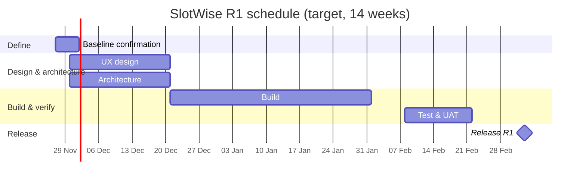

# Milestone Plan: SlotWise

## 1. Milestones

| ID | Milestone | Exit criteria (evidence) | Target date | Owner | Depends on | Status |
|---|---|---|---|---|---|---|
| M1 | Discovery and PRD baseline | Approved PRD, Goals & Metrics, User Stories and Risk Register; scope FR-001 to FR-005 confirmed | 2026-11-27 | PM | none | Complete |
| M2 | Design freeze (R1) | Booking and owner-calendar designs reviewed; flow and screen refs agreed with designer | 2026-12-18 | Designer | M1 | Planned |
| M3 | Architecture baselined | Architecture Overview, ADR-0001, ADR-0002, data model and API spec reviewed | 2026-12-18 | Eng Lead | M1 | Planned |
| M4 | Feature complete (R1) | US-001 to US-005 done; no open Critical defects; FR-006 held for R2 per DEC-003 | 2027-02-05 | Eng Lead | M2, M3 | Planned |
| M5 | Release candidate | Test Strategy gates met; TS-001 to TS-010 executed; UAT signed off | 2027-02-26 | QA | M4 | Planned |
| M6 | Release R1 | Go/no-go passed; deployed to three pilot salons | 2027-03-05 | PM | M5 | Planned |
| M7 | 90-day post-launch review | MET-01, MET-02 and MET-03 reviewed; decisions logged | 2027-06-03 | PM | M6 | Planned |

*(Milestone IDs here are local to this plan, to avoid clashing with the `MET-` metric IDs; they are not a traceability prefix.)*

## 2. Timeline

## 3. Critical Path and Buffer

| Item | Detail |
|---|---|
| Critical path | M1 then M2 and M3 in parallel, then M4, M5 and M6; M7 follows after launch |
| Buffer | 5 working days held between M5 and M6; only the PM may spend it, with Eng Lead agreement |
| Fixed dates and external dependencies | DEP-01 messaging provider account and sandbox available by 2026-12-18; three pilot salons confirmed by 2027-02-05; launch target 2027-03-05 under CON-01 |

## 4. Progress Tracking

| Milestone | Baseline date | Forecast | Variance | Notes / recovery action |
|---|---|---|---|---|
| M1 | 2026-11-27 | 2026-11-27 | None | Baseline documents approved 2026-11-10 |
| M2 | 2026-12-18 | On target | None | Weekly design review from 2026-11-30 |
| M3 | 2026-12-18 | On target | None | DEP-01 sandbox decision needed by 2026-12-11 |
| M4 | 2027-02-05 | On target | None | Scope check weekly against RISK-04 |
| M5 | 2027-02-26 | On target | None | Uses the 5-day buffer if TS-002 or UAT slips |
| M6 | 2027-03-05 | On target | None | Go/no-go in the Release Plan |
| M7 | 2027-06-03 | On target | None | 90 days after launch |

**Review rule:** if a milestone forecast slips by more than 5 working days, raise it at the next Monday review and log a decision in the [Decision Log](../00-foundation/decision-log.md) to re-scope, add time or add capacity.

## 5. Dependencies and Risks

| ID | Effect on dates | Mitigation |
|---|---|---|
| RISK-01 | Reminder timing may need pilot changes, delaying confidence in MET-01 | Resolve Q-001 in pilot week 6 |
| RISK-02 | DEP-01 outage delays reminders | Queue with retries per ADR-0002; alert on backlog via MON-003 |
| RISK-03 | Double bookings could hold M5 | Transaction guard per ADR-0001; TS-002 before M5 |
| RISK-04 | 14-week capacity under CON-01 | FR-006 deferred to R2 per DEC-003; weekly scope check |
| DEP-01 | Provider onboarding blocks M3 and M5 | Confirm account and sandbox by 2026-12-18 |

## Completion Criteria

- [x] Each milestone has verifiable exit criteria, an owner and a date.
- [x] Dates are consistent with the Roadmap, Release Plan and Charter constraints.
- [x] Critical path, buffer and external dependencies are explicit.
- [x] Baseline is saved and a review cadence is set.
