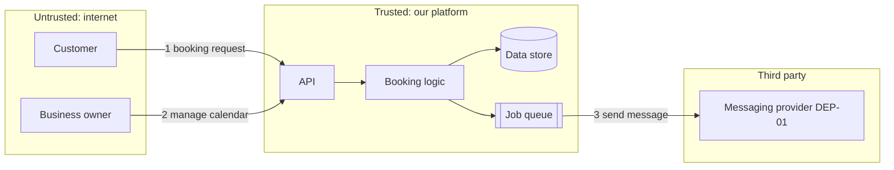

# Threat Model: SlotWise

## 1. Scope and Assumptions

| | |
|---|---|
| **System / feature in scope** | R1 booking web app, booking service, data store, message queue, notification worker and DEP-01 delivery boundary |
| **Out of scope** | DEP-01 internal systems, salon devices and networks, payments excluded by DEC-001, FR-006 deferred by DEC-003 |
| **Assumptions** | ASM-01, customers accept a booking link; a booking link token is unguessable; the hosting provider secures the physical layer |
| **Version of design analysed** | Architecture Overview v1.0.0, dated 2026-11-10 |
| **Participants and date** | Security lead, engineering lead and PM on 2026-11-27 |

## 2. Assets

| Asset | Why it matters | Classification | Owner |
|---|---|---|---|
| Customer contact details, PD-01 and PD-02 | Privacy harm and loss of trust | Confidential | Product |
| Booking records | Integrity of the salon calendar and MET-01 | Internal | Product |
| Credentials, link tokens and provider keys | Gate to all data | Restricted | Engineering |
| Availability of the booking page | Revenue for pilot salons and GOAL-02 | Not classified, availability target NFR-002 | Engineering |

## 3. Data Flow and Trust Boundaries

| Flow | From → To | Data | Boundary crossed | Protection |
|---|---|---|---|---|
| 1 | Customer → API | Name and phone | Internet → platform | Encrypted transport, server-side validation SR-005 |
| 2 | Owner → API | Session token and availability changes | Internet → platform | Authentication and tenant check SR-001, SR-002 |
| 3 | Queue → DEP-01 | Phone number and message text | Platform → vendor | Encrypted transport, processor agreement, no secrets in message body |

## 4. Threat Catalog

| ID | Element / flow | Category | Threat (who does what, to get what) | Likelihood | Impact | Decision | Mitigation (SR- / design) | Residual risk | Status |
|---|---|---|---|---|---|---|---|---|---|
| TH-001 | Flow 1 | Spoofing | An attacker books slots with someone else's phone number to harass that person | Medium | Medium | Mitigate | SR-006 rate limiting, phone format validation, salon review of bookings | Low | Open |
| TH-002 | API | Elevation of privilege | A caller guesses a booking or owner identifier and changes another salon's calendar | Medium | High | Mitigate | SR-001, SR-002, non-sequential identifiers in ADR-0005 | Low | Open |
| TH-003 | Data store | Information disclosure | A query without a tenant filter returns another salon's customer list | Low | High | Mitigate | SR-002, mandatory tenant key and negative tests in TS-001 and TS-008 | Low | Open |
| TH-004 | Flow 1 | Tampering | A customer submits crafted text in name or phone to alter a query or page output | Medium | Medium | Mitigate | SR-005 server-side validation and context encoding | Low | Open |
| TH-005 | Booking endpoint | Denial of service | Scripted requests reserve or hold many slots | High | Medium | Mitigate | SR-006 rate limiting, MON-005 anomaly alert, manual review | Medium | Open |
| TH-006 | Support tooling | Repudiation | A support agent views customer data with no trace | Medium | Medium | Mitigate | SR-007 audit events reviewed weekly | Low | Open |
| TH-007 | Configuration and logs | Information disclosure | A provider key or link token is committed to source control or written to logs | Low | High | Mitigate | SR-004 managed secret store, 90-day rotation, log masking | Low | Open |

**Category prompts:** *S* pretending to be someone else · *T* changing data or code without permission · *R* denying an action when no evidence exists · *I* exposing data to those not entitled · *D* making the service unavailable · *E* gaining capabilities not granted.
**Decision options:** Mitigate · Avoid (change the design) · Transfer · Accept (with owner and review date).

## 5. Residual Risk and Hand-offs

| Threat | Residual risk | Risk ID | Accepted by / date |
|---|---|---|---|
| TH-005 | Medium | RISK-04 | PM, 2027-03-05 review date |

Hand-offs: new requirements go to [Security Requirements](security-requirements.md), test ideas to the [Test Strategy](../07-quality/test-strategy.md), and accepted or unresolved threats to the [Risk Register](../06-project-mgmt/risk-register.md).

## 6. Review Log

| Date | Trigger (new feature, incident, quarterly) | Changes | Reviewer |
|---|---|---|---|
| 2026-11-27 | Initial model for R1 pilot | Seven threats catalogued, decisions recorded | Security lead |

Next review is due 2027-02-19 before UAT, and then whenever a new external integration is added.

## Completion Criteria

- [x] Scope, assumptions and the design version analysed are stated.
- [x] Assets are identified and classified; trust boundaries are drawn on a data-flow diagram.
- [x] Every boundary-crossing flow was examined for each threat category (or the method's equivalent).
- [x] Each threat has a decision, an owner, and a mitigation that traces to an `SR-` requirement or design change.
- [x] Residual and accepted risks are in the Risk Register with owners.
- [x] A review trigger or date is set.
