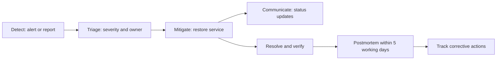

# Incident Management Plan: SlotWise

## 1. Definitions and Severity

| Severity | Definition (user impact) | Example | Response target | Update cadence |
|---|---|---|---|---|
| SEV1 | Core function unavailable or data at risk for many users | Booking or public booking link failing for all pilot salons | Immediate page during 09:00 to 20:00 UTC salon hours | Every 30 minutes |
| SEV2 | Major function degraded; workaround exists | Reminders delayed more than 1 hour, DEP-01 issue, or error rate above 2% | Within 30 minutes during salon hours | Every 60 minutes |
| SEV3 | Minor impact | Cosmetic error on one booking page | Next business day | As needed |

Outside 09:00 to 20:00 UTC, SEV1 pages the on-call engineer and SEV2 and SEV3 start the next business day. These targets fit the 2-engineer team under CON-01.

## 2. Roles

| Role | Responsibility | Primary | Backup |
|---|---|---|---|
| Incident commander | Coordinates, decides, tracks timeline | PM | Engineering lead |
| Technical lead | Diagnoses and fixes | Engineering lead | Second engineer |
| Communications lead | Updates salons and stakeholders | PM | QA lead |
| Scribe | Records timeline and actions | QA lead | Designer |

## 3. Response Process

| Phase | Actions |
|---|---|
| Detect | Alerts MON-001 to MON-005, salon reports through the support channel, checks during hypercare |
| Triage | Assign severity and commander, open an incident record with UTC start time |
| Mitigate | Roll back per the [Deployment Plan](deployment-plan.md), disable the booking-link flag, fail over, scale, or block abuse; record each change |
| Communicate | Message pilot salons by email, internal team channel update, PM briefing |
| Resolve | Confirm recovery through NFR-002 availability target and MON-001, then close the incident |
| Learn | Blameless postmortem for SEV1 and SEV2 within 5 working days |

## 4. Communication

| Audience | Channel | Template message | Owner |
|---|---|---|---|
| Pilot salons | Email to the three salon owners | "We are investigating a booking issue. Impact: public booking link may be unavailable. Next update at HH:MM UTC." | PM |
| Customers via salons | Salon phone or in-person notice | "Online booking is temporarily unavailable. Please call the salon. We will post an update when it returns." | Salon owner |
| Internal team | Team chat channel | "SEV1 open, commander PM, technical lead Eng Lead, start time UTC, current impact and next update time" | Scribe |
| Sponsor | Email summary at resolution | "Incident summary, duration, impact and corrective actions with owners and due dates" | PM |

## 5. Postmortem Template (blameless)

| Section | Content |
|---|---|
| Summary | What happened, which salons were affected, duration in UTC |
| Timeline | Detection to resolution, with UTC timestamps |
| Impact | Salons, bookings affected, MET-01 data impact, availability budget used |
| Root cause and contributing factors | Systems and process only, no individual blame |
| What went well / poorly / luck | Three short lists from the team |
| Corrective actions | Action, owner, due date, linked RISK- ID or DEC- ID |

## 6. Security Incidents and Personal-Data Breaches

For a suspected breach of PD-01 or PD-02, the on-call engineer contains access, the security lead preserves evidence and reviews SR-007 audit events, and the PM assesses which salons and customers are affected. Legal and contractual notification duties and deadlines are to be determined with qualified advice before launch, with the named notifier recorded in [Privacy Requirements](../08-security/privacy-requirements.md). The PM owns regulator and customer notification once that advice exists. No notification claim is made in this draft.

## 7. Contacts and Tools

The on-call rotation and phone numbers live in the team calendar, not in this repository. DEP-01 support contact details live in the provider account. Incident records and postmortems live in the tool-agnostic tracker, with the runbook index linked from [Operational Readiness](operational-readiness.md). The support briefing and known issues list are maintained by the PM.

## Completion Criteria

- [x] Severity levels are defined by user impact with realistic response targets.
- [x] Roles and backups are assigned; on-call exists for SEV1.
- [x] Communication paths and templates exist for customers and internal teams.
- [x] A blameless postmortem process with tracked actions is defined.
- [x] Security and personal-data incident handling and legal notification duties are identified.
- [ ] The plan was tested through a drill or tabletop exercise.
