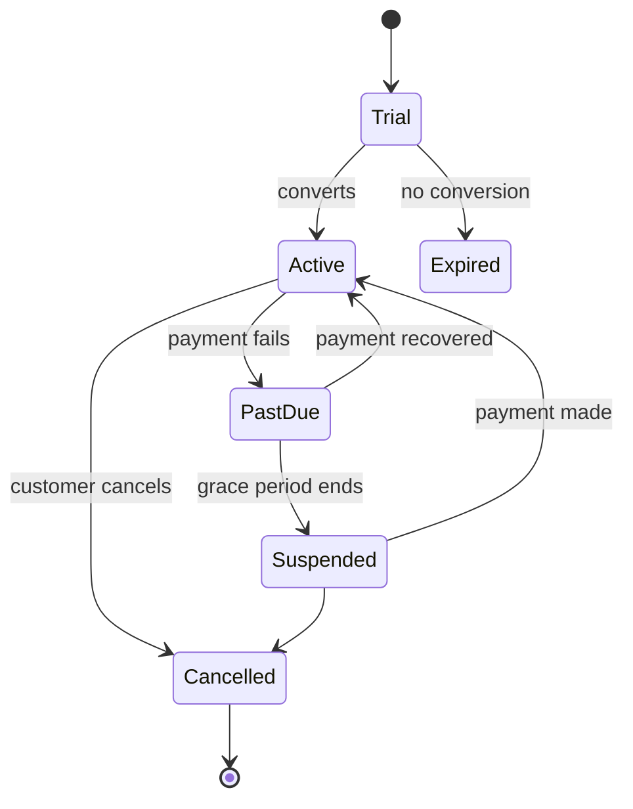

# Subscription and Billing Requirements: SlotWise

## 1. Plans and Packaging

| Plan | Price and billing period | Included entitlements | Limits / metered items | Target tenant |
|---|---|---|---|---|
| Pilot | Manual invoice, monthly, price agreed with each pilot salon | FR-001 to FR-005, online booking and reminders | 3 pilot salons, DEP-01 messages tracked per salon | PER-01 pilot owners |
| Standard | Price to be confirmed by PM and sponsor before open sign-up | Same entitlements as Pilot | Salon count and message volume reviewed after the pilot | Small salons, target 40 by 2027-06-03 |
| Premium | Not offered in R1 | Planned for R2 after the 90-day review | To be decided then | Future larger salons |

**Entitlements model:** R1 uses one entitlement set for all salons, enforced by the salon account rather than by plan. Automated plan enforcement is deferred with payments under DEC-001. MET-03 counts salons with a paid manual invoice at day 90.

## 2. Subscription Lifecycle

Payments and automated checkout are out of scope for R1 per DEC-001, so the state diagram below is the R2 target. In R1 the PM records Pilot status as invoiced, paid or stopped in billing records.

| Event / rule | Requirement | BR- |
|---|---|---|
| Trial | R2 target, 14 days, no payment method in R1 | Not assigned in R1 |
| Upgrade / downgrade | Not available in R1, one entitlement set for all salons | Not assigned in R1 |
| Cancellation | Owner notifies PM; booking link disabled, owner calendar kept | Not assigned in R1 |
| Renewal | Monthly manual invoice in R1; automatic renewal deferred | Not assigned in R1 |
| Failed payment | PM follows up by email, 14-day grace, then suspension of booking link | Not assigned in R1 |
| Reactivation | On payment, booking link re-enabled within 1 working day | Not assigned in R1 |
| Refunds and credits | Case by case, PM and sponsor approve | Not assigned in R1 |

## 3. Invoicing, Taxes and Currency

| Topic | Requirement |
|---|---|
| Invoice content and numbering | Invoice id, salon name, billing period, entitled services, amount and issue date; format to be verified with qualified advice |
| Currencies and rounding | Single currency for the pilot, confirmed by PM and sponsor before the first invoice |
| Taxes | Applicable taxes per market to be identified and verified with qualified advice; no claim is made in this draft |
| Payment methods | Bank transfer for the pilot, no card data handled by SlotWise |
| Receipts and statements | Monthly receipt sent by PM after payment is recorded |
| Customer billing portal | Not in R1; manual process owned by PM |

## 4. Payment Handling and Security

DEC-001 excludes payments from R1, and SlotWise stores no card data and integrates with no payment provider. The PM keeps billing records with salon name, invoice id, period and paid status; those records are the source for MET-03. Access to billing information is limited to the owner, PM and platform administrator under the [Access Control Matrix](../../08-security/access-control-matrix.md). DEP-01 is the only external vendor in R1 and handles messages, not money.

## 5. Reconciliation and Reporting

| Item | Requirement |
|---|---|
| Revenue and subscription reports | MET-03 paying salon count in [Analytics Plan](../../10-analytics/analytics-plan.md); MRR and churn definitions deferred to R2 |
| Reconciliation with the provider and accounting | Monthly manual check of paid invoices against booking accounts, owner PM |
| Audit trail of billing changes | Invoice id, status change, actor and UTC timestamp retained for 13 months |

## 6. Edge Cases to Decide

Mid-cycle plan changes, disputed charges, currency changes, a change of legal entity, and data export on cancellation are all deferred to R2 because payments are out of scope. Each decision is recorded in the Decision Log with an owner and a due date before it affects a customer. For R1, a cancellation keeps the salon's booking data available to the owner for export under NFR-004.

## Completion Criteria

- [x] Plans, entitlements and limits are defined and match the Business Model.
- [x] The subscription lifecycle and failed-payment behaviour are fully specified as testable rules.
- [ ] Tax, invoicing and payment-data obligations are identified and verified by qualified advice.
- [x] Reconciliation, reporting and audit trail exist.
- [x] Edge cases are decided and covered by scenarios.
