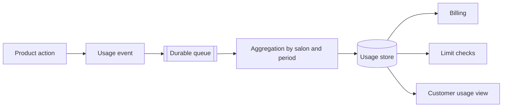

# Usage Metering: SlotWise

## 1. Meters

| Meter | Unit | Definition (what counts, what does not) | Used for | Granularity | Source of truth |
|---|---|---|---|---|---|
| Messages sent | Message | A delivered confirmation or reminder; retries of the same message count once, sandbox messages and cancelled reminders do not count | DEP-01 cost attribution and R2 quota | Per salon per day | Message delivery log from ADR-0002 |
| Active staff seats | Seat | Staff accounts enabled for a salon during the billing period | Plan sizing in R2 | Per salon per month | Account store from US-004 |
| Storage | GB | Average daily stored booking data for the salon, backups excluded | Capacity limits | Per salon | Data store metrics |

No meter produces a customer charge in R1 because payments are out of scope under DEC-001.

## 2. Counting Rules

| Topic | Rule |
|---|---|
| Idempotency | Each billable event carries a unique message id or staff id; duplicates are ignored |
| Exactly-once vs at-least-once | Delivery events are at-least-once from the queue; aggregation deduplicates by message id before counting |
| Time boundaries | UTC calendar day and month; salon local time is used only in reports, not for counting |
| Late or corrected events | Accepted up to 24 hours after the period closes; later corrections need PM approval and an audit note |
| Failures and refunds | Failed deliveries are not counted as delivered; a later successful retry counts once |
| Testing and internal usage | Sandbox messages and internal test salons are marked and excluded from all reports |

## 3. Collection and Storage

| Topic | Requirement |
|---|---|
| Durability | Usage events are written to the durable queue from ADR-0002 and can be replayed after a failure |
| Latency | Aggregates available daily by 03:00 UTC for cost reports; near real-time limit checks are an R2 target |
| Retention | Raw events 13 months, daily aggregates 24 months, then deleted |
| Access | PM and engineering lead see all salon data; salon owners see only their own summary; support access is audited under SR-007 |

## 4. Limits, Alerts and Overages

| Topic | Rule |
|---|---|
| Soft limits | PM notifies the owner at 80% and 100% of the agreed DEP-01 message allowance |
| Hard limits | No booking is blocked in R1; the queue keeps retrying and MON-003 alerts on backlog |
| Overage pricing | Not applicable in R1; price to be confirmed by PM and sponsor before open sign-up |
| Anomalies | MON-005 alerts on a daily message volume spike above 50% or DEP-01 failure rate above 1% |

## 5. Customer Visibility

In R1 the PM sends each pilot salon a monthly summary of confirmed messages, active staff and stored data with the manual invoice. There is no self-service usage dashboard. A salon owner can dispute a line item by contacting the PM, who checks the message delivery log and records the outcome with an audit note. A usage view is an R2 target after the 90-day review.

## 6. Reconciliation and Audit

On the first working day of each month, the engineering lead compares aggregated message counts with the DEP-01 invoice and records any difference. The PM resolves disputes within 5 working days using the message id trail. Audit notes keep the salon id, period, old value, new value, actor and UTC timestamp for 13 months. Billing records are the source for MET-03 in [Analytics Plan](../../10-analytics/analytics-plan.md).

## Completion Criteria

- [x] Each meter has a precise definition, unit and source of truth.
- [x] Counting rules cover duplicates, late events, failures and time boundaries.
- [x] Storage is durable and access-controlled with defined retention.
- [x] Limits, alerts and overage behaviour are defined.
- [x] Customers can see and dispute usage; reconciliation exists.
