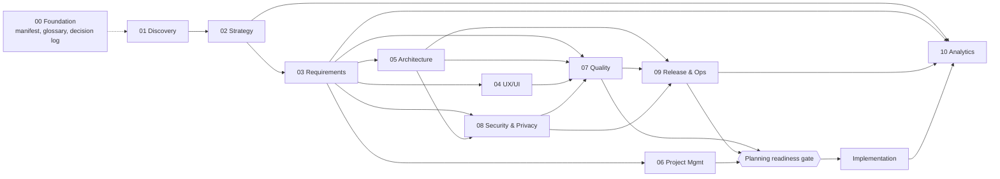
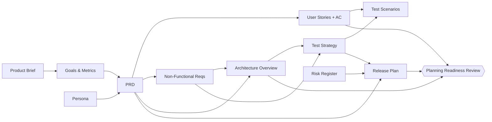

# Document Map and Dependencies

This guide shows **which documents exist, how important each is, and what depends on what**, so you can choose a sensible set and fill it in a sensible order.

> The catalog in section 5 is **generated from the frontmatter** of every template (`scripts/generate-document-map`). If you change a template's `tier`, `owner` or `depends_on`, regenerate it rather than editing the table by hand.

## 1. Tiers

| Tier | Meaning | Count |
|---|---|---|
| **Mandatory** | Needed for almost every product before building starts. Skip only with a written reason. | 10 |
| **Recommended** | Strongly advised for teams and for products of meaningful size or risk. Solo and small projects pick the ones they need. | 44 |
| **Optional** | Valuable in specific situations. Create when the trigger described in the template's *When to use* applies. | 17 |
| **Package** | Product-type-specific documents in `packages/`. Create when your product type matches. | 17 |

"Not applicable" is a legitimate status for any non-mandatory document, and for a mandatory one if you record why. See [profiles](profiles.md) for ready-made selections.

## 2. Domain-Level Flow

Arrows mean "informs". The loops are real: discovery findings change strategy, and post-launch analytics (10) feed back into discovery and strategy.

## 3. The Core Chain

## 4. Recommended Sequence

| Phase | Goal | Typical documents (in order) | Exit check |
|---|---|---|---|
| **A. Discover** | Understand the problem and people | Product Brief → Assumption Map → User Research → Persona → Competitor Analysis (→ Market Research, Opportunity Assessment if needed) | Brief is clear; top assumptions have tests |
| **B. Define strategy** | Decide direction and success | Vision & Value Proposition → Goals & Metrics → Business Model → MVP & Prioritization → Roadmap | Every goal has a metric; MVP hypothesis stated |
| **C. Specify** | State what will be built | PRD → NFRs → Business Rules → User Stories → (Use Cases) → RTM | Must requirements have stories and criteria |
| **D. Design and architect** | Decide how it works and looks | Information Architecture → User Flow → Wireframe Spec → Architecture Overview → ADRs → Data Model → API Specification → Auth design → Infrastructure → Tech Stack; Design System & Accessibility alongside | Drivers trace to requirements; key decisions recorded |
| **E. Secure** | Identify and mitigate threats | Data Classification → Privacy Requirements → Threat Model → Security Requirements → Access Control Matrix (→ Compliance Assessment) | Threats have mitigations; data is classified |
| **F. Plan delivery and quality** | Prepare to build and verify | Project Charter → Milestone Plan → Working Agreements → Test Strategy → Test Plan → Test Scenarios (→ Performance/Security/UAT plans) | Test strategy agreed; milestones have exit criteria |
| **G. Prepare release and operations** | Prepare to run it | Environment Strategy → Deployment Plan → Release Plan → Observability → Incident Mgmt → Backup & Recovery → Operational Readiness (→ Launch & Support) | Rollback and recovery defined |
| **H. Measure** | Prepare to learn | Analytics Plan → Event Tracking Plan → User Feedback Plan | Every metric has a data source |
| **Gate** | Decide to start building | Planning Readiness Review | ★ items pass or gaps accepted |
| **After launch** | Close the loop | Post-Launch Review → feeds Roadmap, Assumption Map, Risk Register | Decisions recorded |

Phases overlap; do not wait for perfection. Work **breadth-first**: draft the mandatory documents roughly, then deepen where risk is highest. Order within a phase is a guide: the real rule is each document's `depends_on` list, shown below.

## 5. Catalog

### 00 Foundation

| Document | Tier | Owner | Depends on |
|---|---|---|---|
| [Decision Log](../templates/00-foundation/decision-log.md) | recommended | product-manager | — |
| [Project Glossary](../templates/00-foundation/glossary.md) | recommended | product-manager | — |
| [Planning Readiness Review (Gate to Implementation)](../templates/00-foundation/planning-readiness-review.md) | mandatory | product-manager | prd, architecture-overview, test-strategy, release-plan, risk-register |

### 01 Product Discovery

| Document | Tier | Owner | Depends on |
|---|---|---|---|
| [Assumption Map](../templates/01-discovery/assumption-map.md) | recommended | product-manager | product-brief |
| [Competitor Analysis](../templates/01-discovery/competitor-analysis.md) | recommended | product-manager | product-brief |
| [Market Research](../templates/01-discovery/market-research.md) | optional | product-manager | product-brief |
| [Opportunity Assessment](../templates/01-discovery/opportunity-assessment.md) | optional | product-manager | product-brief |
| [User Persona](../templates/01-discovery/persona.md) | recommended | product-manager | product-brief |
| [Product Brief](../templates/01-discovery/product-brief.md) | mandatory | product-manager | — |
| [User Research Plan and Findings](../templates/01-discovery/user-research.md) | recommended | ux-researcher | product-brief |

### 02 Product Strategy

| Document | Tier | Owner | Depends on |
|---|---|---|---|
| [Business Model](../templates/02-strategy/business-model.md) | recommended | product-manager | vision-and-value-proposition, market-research |
| [Goals and Success Metrics](../templates/02-strategy/goals-and-metrics.md) | mandatory | product-manager | product-brief |
| [MVP Definition and Feature Prioritization](../templates/02-strategy/mvp-and-prioritization.md) | recommended | product-manager | goals-and-metrics, assumption-map |
| [Product Roadmap](../templates/02-strategy/roadmap.md) | recommended | product-manager | goals-and-metrics, mvp-and-prioritization |
| [Product Vision and Value Proposition](../templates/02-strategy/vision-and-value-proposition.md) | recommended | product-manager | product-brief |

### 03 Requirements Engineering

| Document | Tier | Owner | Depends on |
|---|---|---|---|
| [Business Rules](../templates/03-requirements/business-rules.md) | recommended | business-analyst | prd |
| [Non-Functional Requirements (NFR)](../templates/03-requirements/non-functional-requirements.md) | mandatory | product-manager | prd |
| [Product Requirements Document (PRD)](../templates/03-requirements/prd.md) | mandatory | product-manager | product-brief, goals-and-metrics |
| [Requirements Traceability Matrix (RTM)](../templates/03-requirements/requirements-traceability-matrix.md) | recommended | business-analyst | prd, user-stories, non-functional-requirements |
| [Use Cases](../templates/03-requirements/use-cases.md) | optional | business-analyst | prd, persona |
| [User Stories and Acceptance Criteria](../templates/03-requirements/user-stories.md) | mandatory | product-manager | prd, persona |

### 04 UX/UI Design

| Document | Tier | Owner | Depends on |
|---|---|---|---|
| [Accessibility and Responsive Design Guidelines](../templates/04-ux-ui/accessibility-and-responsive.md) | recommended | designer | non-functional-requirements |
| [Design System and UI Guidelines](../templates/04-ux-ui/design-system.md) | recommended | designer | information-architecture, accessibility-and-responsive |
| [Information Architecture and Sitemap](../templates/04-ux-ui/information-architecture.md) | recommended | designer | prd, persona |
| [Prototype Review](../templates/04-ux-ui/prototype-review.md) | optional | designer | wireframe-spec, user-flow |
| [User Flow](../templates/04-ux-ui/user-flow.md) | recommended | designer | prd, information-architecture, persona |
| [Wireframe Specification](../templates/04-ux-ui/wireframe-spec.md) | recommended | designer | user-flow, information-architecture |

### 05 System Architecture

| Document | Tier | Owner | Depends on |
|---|---|---|---|
| [Architecture Decision Record (ADR)](../templates/05-architecture/adr.md) | recommended | engineering-lead | architecture-overview, non-functional-requirements |
| [API Specification](../templates/05-architecture/api-specification.md) | recommended | engineering-lead | architecture-overview, data-model, authentication-authorization |
| [Architecture Overview](../templates/05-architecture/architecture-overview.md) | mandatory | engineering-lead | prd, non-functional-requirements |
| [Authentication and Authorization Design](../templates/05-architecture/authentication-authorization.md) | recommended | security-lead | architecture-overview, security-requirements |
| [Component Design](../templates/05-architecture/component-design.md) | optional | engineering-lead | architecture-overview, adr |
| [Data Model (ERD and Data Dictionary)](../templates/05-architecture/data-model.md) | recommended | engineering-lead | architecture-overview, business-rules |
| [Infrastructure and Scalability Strategy](../templates/05-architecture/infrastructure-and-scalability.md) | recommended | engineering-lead | architecture-overview, non-functional-requirements |
| [Integration Specification](../templates/05-architecture/integration-specification.md) | optional | engineering-lead | architecture-overview, api-specification |
| [Technology Stack Selection](../templates/05-architecture/technology-stack.md) | recommended | engineering-lead | architecture-overview, non-functional-requirements |

### 06 Project Management

| Document | Tier | Owner | Depends on |
|---|---|---|---|
| [Communication Plan](../templates/06-project-mgmt/communication-plan.md) | optional | project-manager | project-charter |
| [Milestone Plan](../templates/06-project-mgmt/milestone-plan.md) | recommended | project-manager | project-charter, roadmap |
| [Project Charter](../templates/06-project-mgmt/project-charter.md) | recommended | project-manager | product-brief, goals-and-metrics |
| [Resource Plan](../templates/06-project-mgmt/resource-plan.md) | optional | project-manager | project-charter, wbs |
| [Risk Register](../templates/06-project-mgmt/risk-register.md) | mandatory | project-manager | prd |
| [Sprint / Iteration Planning](../templates/06-project-mgmt/sprint-planning.md) | optional | project-manager | user-stories, working-agreements, milestone-plan |
| [Work Breakdown Structure (WBS)](../templates/06-project-mgmt/wbs.md) | optional | project-manager | project-charter, prd |
| [Working Agreements (Definition of Ready and Definition of Done)](../templates/06-project-mgmt/working-agreements.md) | recommended | project-manager | test-strategy, project-charter |

### 07 Quality Assurance

| Document | Tier | Owner | Depends on |
|---|---|---|---|
| [Performance Test Plan](../templates/07-quality/performance-test-plan.md) | optional | qa-lead | non-functional-requirements, test-strategy, infrastructure-and-scalability |
| [Security Test Plan](../templates/07-quality/security-test-plan.md) | optional | security-lead | security-requirements, threat-model, test-strategy |
| [Test Case](../templates/07-quality/test-case.md) | recommended | qa-lead | test-scenarios, test-strategy |
| [Test Data Management](../templates/07-quality/test-data-management.md) | optional | qa-lead | test-strategy, data-model |
| [Test Plan](../templates/07-quality/test-plan.md) | recommended | qa-lead | test-strategy, prd, user-stories |
| [Test Scenarios](../templates/07-quality/test-scenarios.md) | recommended | qa-lead | user-stories, test-strategy, business-rules, non-functional-requirements |
| [Test Strategy](../templates/07-quality/test-strategy.md) | mandatory | qa-lead | prd, non-functional-requirements, architecture-overview |
| [User Acceptance Testing (UAT) Plan](../templates/07-quality/uat-plan.md) | recommended | product-manager | user-stories, test-plan, use-cases |

### 08 Security and Compliance

| Document | Tier | Owner | Depends on |
|---|---|---|---|
| [Access Control Matrix](../templates/08-security/access-control-matrix.md) | recommended | security-lead | authentication-authorization, data-classification |
| [Compliance Assessment](../templates/08-security/compliance-assessment.md) | optional | compliance-lead | security-requirements, privacy-requirements |
| [Data Classification](../templates/08-security/data-classification.md) | recommended | security-lead | architecture-overview, data-model |
| [Privacy Requirements](../templates/08-security/privacy-requirements.md) | recommended | product-manager | data-classification, data-model |
| [Security Requirements](../templates/08-security/security-requirements.md) | recommended | security-lead | non-functional-requirements, architecture-overview |
| [Threat Model](../templates/08-security/threat-model.md) | recommended | security-lead | architecture-overview, data-classification |

### 09 Release and Operations

| Document | Tier | Owner | Depends on |
|---|---|---|---|
| [Backup and Recovery Plan](../templates/09-release-ops/backup-and-recovery.md) | recommended | operations-lead | non-functional-requirements, data-model, infrastructure-and-scalability |
| [Deployment Plan](../templates/09-release-ops/deployment-plan.md) | recommended | engineering-lead | release-plan, environment-strategy, infrastructure-and-scalability |
| [Environment Strategy](../templates/09-release-ops/environment-strategy.md) | recommended | engineering-lead | architecture-overview, infrastructure-and-scalability |
| [Incident Management Plan](../templates/09-release-ops/incident-management.md) | recommended | operations-lead | observability-strategy, operational-readiness |
| [Launch and Support Plan](../templates/09-release-ops/launch-and-support-plan.md) | optional | product-manager | release-plan, vision-and-value-proposition |
| [Maintenance Plan](../templates/09-release-ops/maintenance-plan.md) | optional | engineering-lead | operational-readiness, technology-stack |
| [Observability Strategy (Monitoring and Logging)](../templates/09-release-ops/observability-strategy.md) | recommended | operations-lead | architecture-overview, non-functional-requirements |
| [Operational Readiness Review](../templates/09-release-ops/operational-readiness.md) | recommended | operations-lead | deployment-plan, observability-strategy, incident-management, backup-and-recovery |
| [Release Plan](../templates/09-release-ops/release-plan.md) | mandatory | product-manager | prd, test-strategy, risk-register |

### 10 Product Analytics

| Document | Tier | Owner | Depends on |
|---|---|---|---|
| [Analytics Plan (KPIs and Product Health Metrics)](../templates/10-analytics/analytics-plan.md) | recommended | product-manager | goals-and-metrics, prd |
| [Event Tracking Plan](../templates/10-analytics/event-tracking-plan.md) | recommended | product-manager | analytics-plan, user-flow, privacy-requirements |
| [Post-Launch Review](../templates/10-analytics/post-launch-review.md) | recommended | product-manager | goals-and-metrics, analytics-plan, release-plan |
| [User Feedback Plan](../templates/10-analytics/user-feedback-plan.md) | optional | product-manager | analytics-plan, launch-and-support-plan |

### Product-Specific Packages

| Document | Applies to | Owner | Depends on |
|---|---|---|---|
| [API Lifecycle and Versioning](../packages/api-platform/api-lifecycle-and-versioning.md) | api-platform, mobile, saas | engineering-lead | api-specification, architecture-overview |
| [API Consumer Authentication Strategy](../packages/api-platform/consumer-authentication.md) | api-platform | security-lead | authentication-authorization, api-specification, security-requirements |
| [Rate Limiting and Quotas](../packages/api-platform/rate-limiting-and-quotas.md) | api-platform, saas | engineering-lead | api-specification, non-functional-requirements, infrastructure-and-scalability |
| [Webhook Specification](../packages/api-platform/webhook-specification.md) | api-platform, saas | engineering-lead | api-specification, consumer-authentication |
| [Developer Experience (DX) Plan](../packages/developer-tools/developer-experience.md) | developer-tools, api-platform | product-manager | prd, persona, api-specification |
| [Distribution and Compatibility](../packages/developer-tools/distribution-and-compatibility.md) | developer-tools | engineering-lead | architecture-overview, technology-stack, non-functional-requirements |
| [Audit Logging Requirements](../packages/enterprise/audit-logging.md) | enterprise, saas | security-lead | security-requirements, access-control-matrix, observability-strategy |
| [Change Management and Training](../packages/enterprise/change-management-and-training.md) | enterprise | product-manager | persona, release-plan, communication-plan |
| [Data Governance](../packages/enterprise/data-governance.md) | enterprise, saas | data-owner | data-classification, privacy-requirements, data-model |
| [Enterprise Integration](../packages/enterprise/enterprise-integration.md) | enterprise | engineering-lead | integration-specification, authentication-authorization, architecture-overview |
| [App Store Release Requirements](../packages/mobile/app-store-release.md) | mobile | product-manager | platform-and-device-support, release-plan, privacy-requirements |
| [Offline Capabilities and Data Sync](../packages/mobile/offline-and-sync.md) | mobile | engineering-lead | architecture-overview, data-model, platform-and-device-support |
| [Platform and Device Support](../packages/mobile/platform-and-device-support.md) | mobile | product-manager | prd, non-functional-requirements |
| [Push Notification Strategy](../packages/mobile/push-notifications.md) | mobile | product-manager | prd, platform-and-device-support, privacy-requirements |
| [Multi-Tenancy and Tenant Isolation](../packages/saas/multi-tenancy-and-isolation.md) | saas | engineering-lead | architecture-overview, data-model, security-requirements |
| [Subscription and Billing Requirements](../packages/saas/subscription-and-billing.md) | saas | product-manager | business-model, prd |
| [Usage Metering](../packages/saas/usage-metering.md) | saas | product-manager | subscription-and-billing, multi-tenancy-and-isolation, data-model |

*Also in `00-foundation`: [project-manifest.yaml](../templates/00-foundation/project-manifest.yaml), the register of which documents your project uses.*
