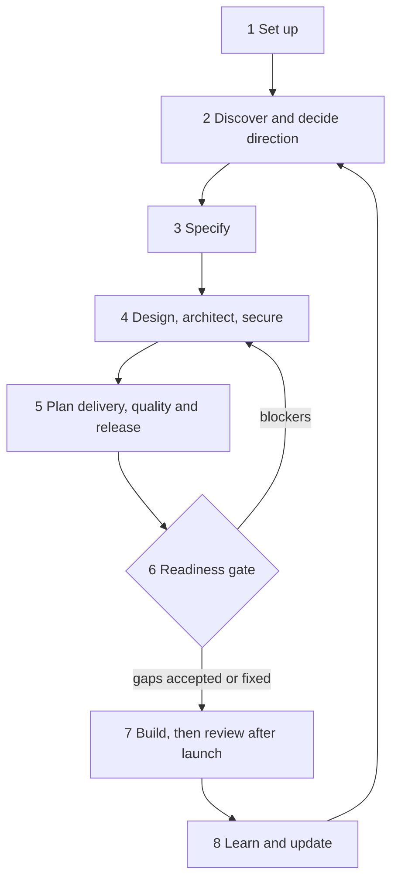

# Recommended Planning Workflow

A step-by-step way to use the framework on a real project. It works for one person or ten; only the amount of ceremony changes. See [profiles](profiles.md) for sizing and the [document map](document-map.md) for dependencies.

## 1. Set Up (about half a day)

1. Create your project repository from this template, or run `scripts/scaffold` with your chosen profile.
2. Edit the [project manifest](../templates/00-foundation/project-manifest.yaml): product type, profile, packages.
3. Decide who owns each mandatory document (one person per document; reviewers separate).
4. Start the [Decision Log](../templates/00-foundation/decision-log.md) and [Glossary](../templates/00-foundation/glossary.md).

## 2. Discover and Decide Direction

1. Write a rough **Product Brief**. List your riskiest assumptions in the **Assumption Map**.
2. Talk to real users. Record findings in **User Research**; sharpen **Persona**.
3. Look at alternatives (**Competitor Analysis**) and, if the business case depends on it, **Market Research**.
4. Write **Vision & Value Proposition**, **Goals & Metrics**, and (commercial products) **Business Model**.
5. Define the **MVP hypothesis** and a prioritised scope; sketch the **Roadmap**.

*Exit check:* you can state the problem, who has it, how you will know you succeeded, and what the smallest test is.

## 3. Specify

1. Write the **PRD** (fill sections 3, 5, 4, 6 first; Executive Summary last).
2. Write **Non-Functional Requirements** with measurable targets.
3. Capture **Business Rules** and **User Stories** with acceptance criteria for all *Must* requirements.
4. Add **Use Cases** only for complex workflows. Start the **RTM** (or rely on `scripts/check-traceability`).

*Exit check:* every Must requirement has a goal, a story and criteria; every NFR is measurable.

## 4. Design, Architect and Secure

Work in parallel, with regular check-ins, since they constrain each other:

- **UX:** Information Architecture → User Flow → Wireframe Spec; Design System and Accessibility guidelines; Prototype Review before locking designs.
- **Architecture:** Architecture Overview (drivers first) → ADRs for significant choices → Data Model → API Specification → Authentication & Authorization → Infrastructure & Scalability → Technology Stack.
- **Security and privacy:** Data Classification → Privacy Requirements → Threat Model (using the architecture's trust boundaries) → Security Requirements → Access Control Matrix.
- **Packages:** add those that match your product type at the point they constrain design (multi-tenancy and offline sync early; billing and app-store release later).

*Exit check:* each architectural driver traces to a requirement; threats have owners; data is classified.

## 5. Plan Delivery, Quality and Release

1. **Project Charter**, **Milestone Plan**, **Working Agreements** (Definition of Ready/Done), **Risk Register** (maintained from day one).
2. **Test Strategy** → **Test Plan** for the first release → **Test Scenarios** derived from acceptance criteria.
3. **Environment Strategy**, **Deployment Plan**, **Release Plan** (with rollback), **Observability Strategy**, **Incident Management**, **Backup & Recovery**, **Operational Readiness**.
4. **Analytics Plan**, **Event Tracking Plan** and **User Feedback Plan** so you can learn after launch.

*Exit check:* quality gates are agreed; rollback and recovery are defined; every metric has a data source.

## 6. The Readiness Gate

1. Run the validation scripts: `scripts/validate-metadata`, `scripts/check-links`, `scripts/check-traceability`.
2. Complete the [Planning Readiness Review](../templates/00-foundation/planning-readiness-review.md).
3. Decide: **proceed**, **proceed with conditions**, or **not ready**. Record the decision in the Decision Log.

## 7. Build and Review

- Keep documents alive: change requirements via a new version and a Decision Log entry; update affected documents (use the traceability IDs to find them).
- Before each release, repeat a light gate: Release Plan criteria, Operational Readiness.
- After launch, run **Post-Launch Review** at the scheduled points.

## 8. Learn and Update

Post-launch results update the Assumption Map, Risk Register, Roadmap and Goals. Feed lessons about the planning process itself back into your own templates, and, if useful to others, into this framework through a pull request.

## Rules of Thumb

- **Breadth first, then depth.** A rough version of every mandatory document beats a perfect first one.
- **Write for the reader who will use it**, not for the reviewer.
- **Unknown is a valid entry.** List it, own it, date it.
- **Stop when the next document would not change a decision.**
- **Documents are not done when they are written;** they are done when the people who depend on them can act on them.
