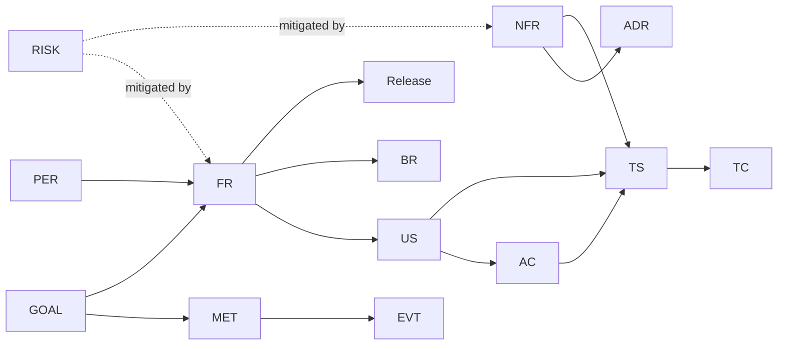

# Traceability and ID Scheme

Traceability answers three questions: *Why does this exist?* (upward), *Is it built and tested?* (downward), and *What breaks if it changes?* (impact). It works only if every item has a stable ID and links to its neighbours.

## 1. ID Prefixes

| Prefix | Item | Defined in (canonical) | Example |
|---|---|---|---|
| `GOAL-` | Business or user goal | Goals & Metrics | GOAL-01 |
| `MET-` | Success metric | Goals & Metrics | MET-01 |
| `PER-` | Persona | Persona | PER-01 |
| `ASM-` | Assumption | Assumption Map / PRD | ASM-03 |
| `CON-` | Constraint | PRD | CON-02 |
| `FR-` | Functional requirement (epic level) | PRD | FR-012 |
| `US-` | User story | User Stories | US-031 |
| `AC-` | Acceptance criterion (`AC-<story>.<n>`) | User Stories | AC-031.2 |
| `UC-` | Use case | Use Cases | UC-004 |
| `BR-` | Business rule | Business Rules | BR-007 |
| `NFR-` | Non-functional requirement | Non-Functional Requirements | NFR-004 |
| `ADR-` | Architecture decision (4 digits) | ADR | ADR-0007 |
| `RISK-` | Risk | Risk Register | RISK-05 |
| `DEP-` | Dependency | PRD / Project Charter | DEP-02 |
| `Q-` | Open question | PRD | Q-04 |
| `DEC-` | Product/project decision | Decision Log | DEC-09 |
| `TS-` | Test scenario | Test Scenarios | TS-020 |
| `TC-` | Test case | Test Case | TC-101 |
| `EVT-` | Analytics event | Event Tracking Plan | EVT-006 |
| `R` | Release (R1, R2…) | Release Plan | R1 |

## 2. Rules

1. **Define once.** An ID is defined in exactly one canonical document. Everywhere else it is only referenced.
2. **Never reuse or renumber.** If an item is dropped, mark it `Retired` and keep the row.
3. **IDs are zero-padded and sequential** within a project; gaps are acceptable.
4. **Reference by ID**, not by title or position.

## 3. The Traceability Chain

Reading the chain:

- **Upward:** every `FR` links to a `GOAL` and a `PER`. An FR with neither is a candidate for removal.
- **Downward:** every *Must* `FR` has at least one `US`; every `US` has at least one `AC`; every `AC` is covered by at least one `TS`.
- **Quality:** every `NFR` with a measurable target is covered by a test scenario or a monitoring rule, and drives at least one `ADR` or design constraint where architecture is affected.
- **Measurement:** every `MET` has at least one `EVT` or other documented data source.

## 4. Requirements Traceability Matrix (RTM)

The [RTM template](../templates/03-requirements/requirements-traceability-matrix.md) is the single table that joins the chain:

| GOAL | FR | Release | US | AC | NFR | ADR | TS | Status |
|---|---|---|---|---|---|---|---|---|
| GOAL-02 | FR-001 | R1 | US-001 | AC-001.1 | NFR-001 | ADR-0002 | TS-001 | Covered |

Keep it small: for solo projects, a RTM can be skipped if `scripts/check-traceability` passes.

## 5. Automated Checks

`scripts/check-traceability` verifies that:

- every referenced ID is defined somewhere;
- no ID is defined twice;
- every *Must* FR has a story, every story an acceptance criterion, every AC a test scenario;
- every NFR with a target is referenced by a test scenario or monitoring item.

Failures are reported as warnings by default and as errors for documents whose status is `approved`.

## 6. Impact Analysis

Before changing an approved item, search its ID across the project: every file that references it is potentially affected. Record the change in the Decision Log, bump the version of the canonical document, and update dependents.
