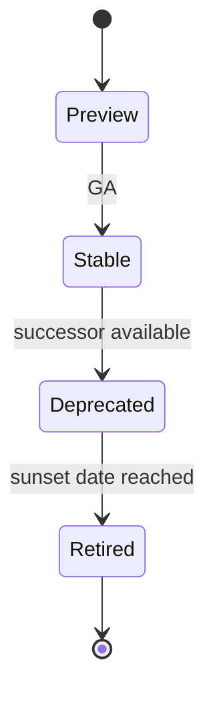

# API Lifecycle and Versioning: [API Name]

<strong>About this template</strong> (delete this block in your copy)

| | |
|---|---|
| **Purpose** | Defines how the API evolves without breaking the people who depend on it: the versioning scheme, what counts as a breaking change, the stages an API or endpoint goes through, deprecation and retirement rules, and how consumers are told. Combines "API lifecycle management" and "API versioning". |
| **When to use** | Before the first external consumer integrates. Also essential for mobile apps (old app versions live for years) and for any partner-facing API. |
| **Owner** | Engineering Lead with Product Manager. |
| **Required inputs** | [API Specification](../../templates/05-architecture/api-specification.md) conventions; consumer inventory; support capacity. |
| **Related documents** | [Webhook Specification](webhook-specification.md) · [Release Plan](../../templates/09-release-ops/release-plan.md) · [Maintenance Plan](../../templates/09-release-ops/maintenance-plan.md) · [App Store Release](../mobile/app-store-release.md) |

> **Guidance:** Your API is a **promise**. Publish the promise (compatibility policy) before you need it. Prefer **additive, backward-compatible change** over new versions; every concurrently supported version multiplies testing and support cost. Decide commitments you can actually keep with your team size.

## 1. Consumers and Commitments

| Consumer group | Examples | How we know them | Change tolerance | Notice they need |
|---|---|---|---|---|
| Own clients (web, mobile) | | | | |
| Partners | | | | |
| Public developers | | | | |

## 2. Compatibility Policy

| Change | Breaking? | Rule |
|---|---|---|
| Add an optional field to a response | No | Allowed any time; clients must ignore unknown fields |
| Add a new endpoint or optional request parameter | No | Allowed |
| Remove or rename a field, endpoint or parameter | **Yes** | New version required |
| Change meaning, type, format or default of a field | **Yes** | New version required |
| Make an optional parameter required | **Yes** | New version required |
| Add a new enum value | [Decide: breaking if clients cannot handle unknown values] | Document explicit client guidance |
| Tighten validation | [Breaking if it rejects previously valid requests] | |
| Change error codes or status behaviour | **Yes** | |
| Change rate limits | [Notice period; see [Rate Limiting & Quotas](rate-limiting-and-quotas.md)] | |

## 3. Versioning Scheme

| Topic | Decision |
|---|---|
| Version identifier | [Major version in path / header / media type] |
| Granularity | [Whole API vs per resource] |
| Minor / patch changes | [Documented in changelog; no version change] |
| Default version for requests without one | [Behaviour] |
| Pre-release / preview access | [Marking, stability promise: none] |

## 4. Lifecycle Stages

| Stage | Meaning | Promise | Entry criteria | Exit criteria |
|---|---|---|---|---|
| Preview | Early access | May change without notice | | |
| Stable | Supported | Compatibility policy applies | Docs, tests, SLOs | |
| Deprecated | Still works; do not start using | Supported until sunset date | Replacement available; notice sent | Sunset date |
| Retired | Removed | Returns a clear error | Usage below threshold or sunset reached | |

## 5. Deprecation and Sunset Process

| Step | Action | Timing | Owner |
|---|---|---|---|
| 1 | Decide and record in Decision Log | | |
| 2 | Announce (changelog, e-mail, in-response signals such as deprecation headers) | At least [N months] before sunset | |
| 3 | Provide migration guide and replacement | With announcement | |
| 4 | Monitor usage per consumer; contact remaining consumers | Monthly | |
| 5 | Brown-outs (temporary shutdowns) to surface hidden dependencies (optional) | | |
| 6 | Retire; keep helpful error responses | | |

## 6. Documentation and Communication

[Changelog location, subscription options, status page, migration guides, support channel for migrating consumers.]

## 7. Testing Compatibility

[Contract tests across supported versions; consumer-driven contract tests with key partners; compatibility checks in CI that detect breaking changes in the API definition.]

## Completion Criteria

- [ ] A compatibility policy classifies changes as breaking or not and is published.
- [ ] The versioning scheme and lifecycle stages are defined, with the support promise for each.
- [ ] Deprecation process, minimum notice periods and migration support are defined and realistic.
- [ ] Usage per consumer and version is measurable.
- [ ] Breaking-change detection is part of the test strategy.
