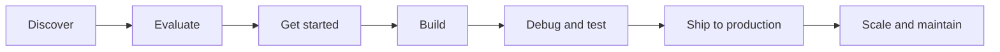

# Developer Experience Plan: [Tool / SDK / API Name]

<strong>About this template</strong> (delete this block in your copy)

| | |
|---|---|
| **Purpose** | Plans the experience of the people who use your product to build things: how they discover it, get started, learn, debug, get help and succeed. For developer tools (CLIs, SDKs, libraries, plugins, APIs), DX *is* the product experience. |
| **When to use** | When the primary users are developers or technical operators. Use alongside the UX documents, which still apply to any graphical interface. |
| **Owner** | Product Manager with a technical writer or developer advocate. |
| **Required inputs** | [Persona](../../templates/01-discovery/persona.md) of the target developers (languages, environments, skill level); [API Specification](../../templates/05-architecture/api-specification.md) or interface design; competitors' DX ([Competitor Analysis](../../templates/01-discovery/competitor-analysis.md)). |
| **Related documents** | [Distribution & Compatibility](distribution-and-compatibility.md) · [Launch & Support Plan](../../templates/09-release-ops/launch-and-support-plan.md) · [User Feedback Plan](../../templates/10-analytics/user-feedback-plan.md) |

> **Guidance:** Measure **time to first success** ("time to hello world"): the minutes from landing on the docs to a working result. Every step you remove raises adoption. Write documentation as a product with an owner, tests and a roadmap. Error messages are part of the interface: they should say what happened, why, and how to fix it.

## 1. Developer Journey

| Stage | Developer's question | What we provide | Friction to remove | Metric |
|---|---|---|---|---|
| Discover | "What is this and is it for me?" | Clear page, use cases | | |
| Evaluate | "Does it work for my case? Is it trustworthy?" | Examples, comparisons, licence, status | | |
| Get started | "Can I get it running in 10 minutes?" | Quickstart | | Time to first success |
| Build | "How do I do X?" | Guides, reference, samples | | |
| Debug | "Why did it fail?" | Error messages, logs, troubleshooting | | |
| Ship | "Is it ready for production?" | Limits, security guidance, stability promise | | |
| Maintain | "What changed? How do I upgrade?" | Changelog, migration guides | | |

## 2. Getting Started

| Item | Requirement |
|---|---|
| Time-to-first-success target | [e.g. ≤ 10 minutes from zero] |
| Account / credentials needed | [Can they try without signing up? sandbox keys] |
| Installation | [Steps, prerequisites; see [Distribution & Compatibility](distribution-and-compatibility.md)] |
| Quickstart | [Copy-paste example that really works; tested in CI] |
| Supported environments | [Languages, runtimes, operating systems] |

## 3. Documentation

| Type | Purpose | Owner | Standard |
|---|---|---|---|
| Quickstart | First success | | Tested on every release |
| Tutorials | Learn by building | | |
| How-to guides | Solve specific tasks | | |
| Reference | Complete, accurate | | Generated from the contract where possible |
| Concepts | Explain the model | | |
| Troubleshooting and FAQ | | | Built from support questions |
| Changelog and migration guides | | | See [API Lifecycle & Versioning](../api-platform/api-lifecycle-and-versioning.md) |
| Examples / sample projects | | | Maintained and tested |

**Documentation quality rules:** accurate versions, runnable code, consistent terminology ([Glossary](../../templates/00-foundation/glossary.md)), accessible, searchable, feedback link on every page.

## 4. Interface Design Principles

| Principle | Consequence for design |
|---|---|
| Sensible defaults, simple common case | |
| Consistency (naming, argument order, behaviour) | |
| Discoverability (help text, completion, typed interfaces) | |
| Helpful, actionable errors | Error format includes code, cause, fix and link |
| Safe by default | Destructive actions require confirmation or a flag |
| Predictable output | Human- and machine-readable modes; stable formats |
| Backwards compatibility | Per compatibility policy |
| Telemetry transparency | If any usage data is collected: explicit, minimal, opt-out documented |

## 5. Support and Community

| Channel | Purpose | Response expectation | Owner |
|---|---|---|---|
| Issue tracker | Bugs and requests | | |
| Discussion forum / chat | Questions | | |
| Status and announcements | | | |
| Contributing guide (if open source) | | | |

## 6. Measuring DX

| Metric | Definition | Target |
|---|---|---|
| Time to first success | Median time in usability sessions | |
| Quickstart completion rate | | |
| Docs search success / page feedback | | |
| Support questions per active developer | | |
| Adoption and retention of developers | | |

Run **developer usability sessions** with people unfamiliar with the product, watching them follow the quickstart unaided.

## Completion Criteria

- [ ] The developer journey identifies friction and metrics at each stage.
- [ ] A time-to-first-success target exists and has been tested with real developers.
- [ ] Documentation types, owners and quality rules are defined; examples are tested in CI.
- [ ] Interface design principles (defaults, errors, consistency, safety) are applied.
- [ ] Support channels, response expectations and DX metrics are defined.
