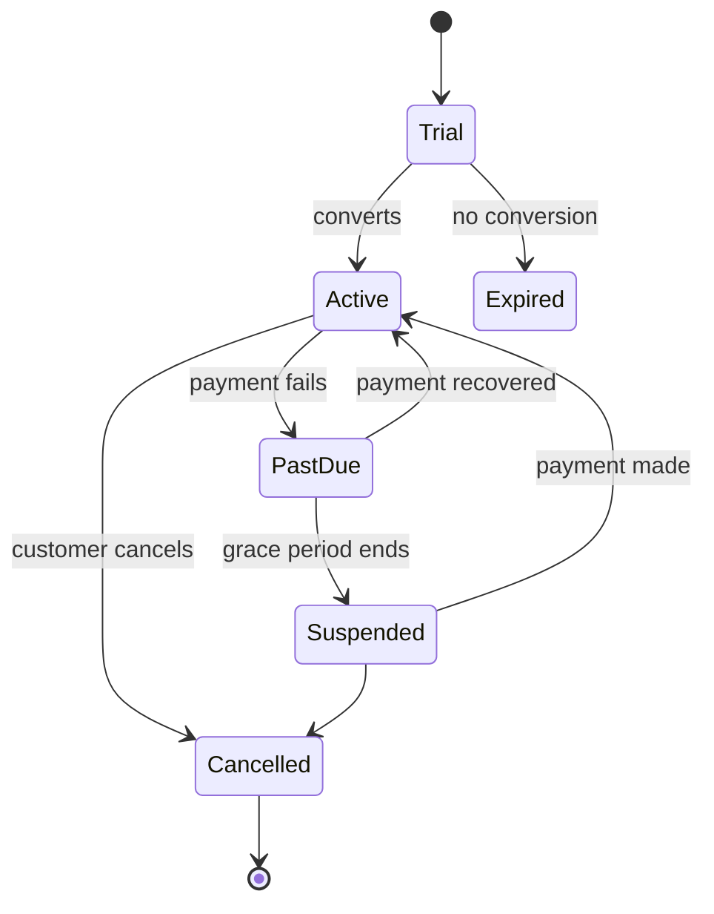

# Subscription and Billing Requirements: [Product Name]

<strong>About this template</strong> (delete this block in your copy)

| | |
|---|---|
| **Purpose** | Specifies the commercial behaviour of the product: plans, trials, subscription lifecycle, invoicing, payment handling, taxes, refunds and what happens when payment fails. Turns the [Business Model](../../templates/02-strategy/business-model.md) into requirements. |
| **When to use** | When the product charges recurring or usage-based fees. Decide the rules before building: billing logic is full of edge cases. |
| **Owner** | Product Manager with Finance. |
| **Required inputs** | [Business Model](../../templates/02-strategy/business-model.md) (pricing, packaging); [PRD](../../templates/03-requirements/prd.md); legal and tax advice for your markets. |
| **Related documents** | [Usage Metering](usage-metering.md) · [Business Rules](../../templates/03-requirements/business-rules.md) · [Integration Specification](../../templates/05-architecture/integration-specification.md) (payment provider) |

> **Guidance:** Treat **money as a regulated, high-risk domain**: confirm tax, invoicing, consumer-protection and payment-data obligations for each market with qualified advice; this template does not state them. Prefer a **payment provider** that keeps card data out of your systems, and record that as an ADR. Write each billing rule as a `BR-` item so it can be tested.

## 1. Plans and Packaging

| Plan | Price and billing period | Included entitlements | Limits / metered items | Target tenant |
|---|---|---|---|---|
| Free | | | | |
| Standard | | | | |
| Premium | | | | |

**Entitlements model:** [How features and limits map to plans; where entitlements are enforced; how changes propagate.]

## 2. Subscription Lifecycle

| Event / rule | Requirement | BR- |
|---|---|---|
| Trial | [Length, requires payment method?, limits] | |
| Upgrade / downgrade | [Immediate vs period end; proration; entitlement change timing] | |
| Cancellation | [Effective date; data access afterwards] | |
| Renewal | [Automatic; notice before renewal] | |
| Failed payment | [Retry schedule; notifications; grace period; suspension effect] | |
| Reactivation | [Within what period; data retained] | |
| Refunds and credits | [Policy; who can issue] | |

## 3. Invoicing, Taxes and Currency

| Topic | Requirement |
|---|---|
| Invoice content and numbering | [Required fields; legal format to verify] |
| Currencies and rounding | |
| Taxes | [Which taxes apply per market; calculation source — verify with qualified advice] |
| Payment methods | |
| Receipts and statements | |
| Customer billing portal | [Self-service: update payment method, view invoices] |

## 4. Payment Handling and Security

[Payment provider and responsibilities; no card data stored by the product unless certified to do so; webhook handling and reconciliation (see [Webhook Specification](../api-platform/webhook-specification.md)); fraud checks; security requirements.]

## 5. Reconciliation and Reporting

| Item | Requirement |
|---|---|
| Revenue and subscription reports | [MRR, churn, etc.; definitions in [Analytics Plan](../../templates/10-analytics/analytics-plan.md)] |
| Reconciliation with the provider and accounting | [Frequency; owner] |
| Audit trail of billing changes | |

## 6. Edge Cases to Decide

[Mid-cycle plan change with usage; disputed charges; currency change; account owner leaves; legal entity change; free-to-paid downgrade over limits; data export on cancellation.]

## Completion Criteria

- [ ] Plans, entitlements and limits are defined and match the Business Model.
- [ ] The subscription lifecycle and failed-payment behaviour are fully specified as testable rules.
- [ ] Tax, invoicing and payment-data obligations are identified and verified by qualified advice.
- [ ] Reconciliation, reporting and audit trail exist.
- [ ] Edge cases are decided and covered by scenarios.
