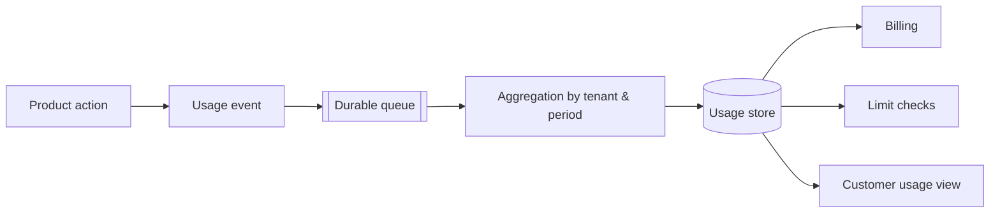

# Usage Metering: [Product Name]

<strong>About this template</strong> (delete this block in your copy)

| | |
|---|---|
| **Purpose** | Defines what usage is measured per tenant, how it is counted accurately, where it is stored, and how it is used for billing, limits, cost control and insight. |
| **When to use** | When pricing, limits or cost allocation depend on usage (messages sent, bookings, seats, storage, API calls). Skip for flat-price products without limits beyond simple seat counts. |
| **Owner** | Product Manager with Engineering. |
| **Required inputs** | [Subscription & Billing](subscription-and-billing.md) pricing metric; [Multi-Tenancy](multi-tenancy-and-isolation.md); [Data Model](../../templates/05-architecture/data-model.md). |
| **Related documents** | [Rate Limiting & Quotas](../api-platform/rate-limiting-and-quotas.md) · [Event Tracking Plan](../../templates/10-analytics/event-tracking-plan.md) · [Infrastructure & Scalability](../../templates/05-architecture/infrastructure-and-scalability.md) |

> **Guidance:** If customers are **charged** by a meter, the meter must be **accurate, explainable and auditable**: customers will dispute numbers. Meter **business units customers understand** (messages sent), not internal resources (CPU seconds), unless that is the product. Keep usage events separate from analytics events: billing data has stricter correctness needs.

## 1. Meters

| Meter | Unit | Definition (what counts, what does not) | Used for | Granularity | Source of truth |
|---|---|---|---|---|---|
| Messages sent | Message | Each delivered confirmation or reminder; retries count once | Billing, quota | Per tenant per day | Delivery log |
| Active staff seats | Seat | Staff accounts active in period | Billing | Per tenant per month | Account store |
| Storage | GB | Average daily stored GB | Limit | Per tenant | |

## 2. Counting Rules

| Topic | Rule |
|---|---|
| Idempotency | Each billable event has a unique id; duplicates are ignored |
| Exactly-once vs at-least-once | [Approach to avoid double or missed counts] |
| Time boundaries | [Time zone; billing period boundaries] |
| Late or corrected events | [Window; adjustments; audit] |
| Failures and refunds | [What happens if a counted action fails or is reversed] |
| Testing and internal usage | Excluded and marked |

## 3. Collection and Storage

| Topic | Requirement |
|---|---|
| Durability | No loss on failure; events are replayable |
| Latency | [Near real time for limits; daily for billing] |
| Retention | [Raw events and aggregates; per legal and billing needs] |
| Access | Tenant sees own data; support access audited |

## 4. Limits, Alerts and Overages

| Topic | Rule |
|---|---|
| Soft limits | Notify at [80%] and [100%] of included usage |
| Hard limits | [Behaviour on exceeding: block, throttle, overage billing] |
| Overage pricing | [Link to plan] |
| Anomalies | Alert on sudden spikes (abuse or bug) |

## 5. Customer Visibility

[Usage dashboard, exports, invoice line-item detail, API for usage.]

## 6. Reconciliation and Audit

[Periodic comparison with source systems; handling of disputes; evidence retained.]

## Completion Criteria

- [ ] Each meter has a precise definition, unit and source of truth.
- [ ] Counting rules cover duplicates, late events, failures and time boundaries.
- [ ] Storage is durable and access-controlled with defined retention.
- [ ] Limits, alerts and overage behaviour are defined.
- [ ] Customers can see and dispute usage; reconciliation exists.
