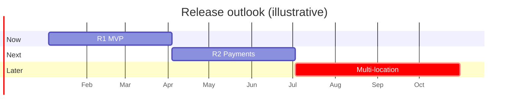

# Product Roadmap: [Product Name]

<strong>About this template</strong> (delete this block in your copy)

| | |
|---|---|
| **Purpose** | Communicates the planned direction and sequence of outcomes over time, at the level of themes rather than tasks. The roadmap is **product-level and outcome-oriented**; the [Milestone Plan](../06-project-mgmt/milestone-plan.md) is the **project-level** schedule of deliverables and dates. |
| **When to use** | After goals and MVP scope; review every quarter or after major learning. |
| **Owner** | Product Manager. |
| **Required inputs** | [Goals & Metrics](goals-and-metrics.md); [MVP & Prioritization](mvp-and-prioritization.md); capacity and dependency information. |
| **Related documents** | [Milestone Plan](../06-project-mgmt/milestone-plan.md) · [PRD](../03-requirements/prd.md) · [Release Plan](../09-release-ops/release-plan.md) |

> **Guidance:** Use **Now / Next / Later** horizons instead of precise dates beyond the next release. Commit to outcomes, not to features. Show confidence decreasing with distance. Never present a roadmap as a promise unless that is the intent.

## 1. Strategic Themes

| Theme | Outcome sought | Goal / metric |
|---|---|---|
| Reliable bookings | Fewer no-shows | GOAL-02 / MET-01 |
| Business growth | Paying accounts | GOAL-01 / MET-03 |

## 2. Roadmap (Now / Next / Later)

| Horizon | Theme | Outcome / problem to solve | Candidate scope (IDs) | Confidence | Release |
|---|---|---|---|---|---|
| **Now** (0–3 months) | Reliable bookings | Customers can self-book and get reminders | FR-001, FR-002 | High | R1 |
| **Next** (3–6 months) | Business growth | Owners can take deposits | C-03 | Medium | R2 |
| **Later** (6+ months) | Expansion | Multi-location support | | Low | — |

## 3. Dependencies and Constraints

| Item | Affects | Owner | Date needed |
|---|---|---|---|

## 4. What We Are Not Doing

[Deliberate exclusions and why. Helps handle stakeholder requests.]

## 5. Change Log and Decisions

| Date | Change | Reason | DEC- |
|---|---|---|---|

## 6. Communication

[Who sees which version of the roadmap (team, leadership, customers); how often it is shared; what is a commitment and what is a direction.]

## Completion Criteria

- [ ] Items are outcomes or problems with linked goals, not just feature names.
- [ ] Horizons show decreasing confidence; dates are only committed for the near term.
- [ ] Scope IDs match the PRD and prioritization decisions.
- [ ] Dependencies and exclusions are visible.
- [ ] A review cadence and change log exist.
