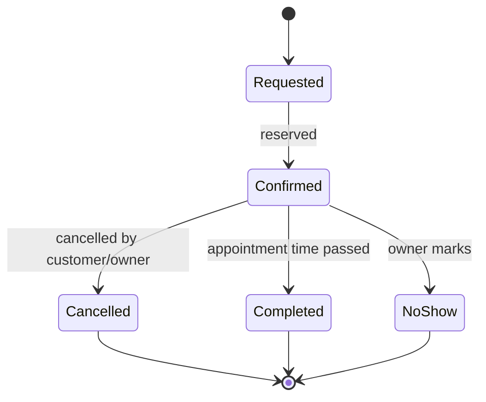

# Business Rules: [Product Name]

<strong>About this template</strong> (delete this block in your copy)

| | |
|---|---|
| **Purpose** | One authoritative catalog of the policies, constraints, calculations and decisions that the product must enforce, independent of any screen or technology. Stories and tests reference rules by ID instead of restating them. Canonical home for `BR-` IDs. |
| **When to use** | When requirements contain policies, thresholds, eligibility, pricing/discount logic, state transitions or regulatory obligations. Skip only if the product has no such logic. |
| **Owner** | Business Analyst or Product Manager, with the business or policy owner as source. |
| **Required inputs** | [PRD](prd.md); policy documents, contracts, regulations (verified by someone qualified). |
| **Related documents** | [User Stories](user-stories.md) · [Data Model](../05-architecture/data-model.md) · [Test Scenarios](../07-quality/test-scenarios.md) |

> **Guidance:** A business rule is **atomic** (one rule per row), **declarative** (what must hold, not how to code it), and has a **named source and owner**. Distinguish: *constraints* (must/must not), *derivations* (calculations), *inferences* (if X then Y) and *authorizations* (who may do what). Do not write rules that merely describe screen behaviour.

## 1. Rule Catalog

| ID | Type | Rule statement | Applies to | Source / owner | Exceptions | Requirements | Status |
|---|---|---|---|---|---|---|---|
| BR-001 | Constraint | A booking must fall inside the business's published availability for the chosen service | Booking | Product policy / PM | None | FR-001 | Approved |
| BR-002 | Constraint | A slot may be reserved by at most one active booking | Booking | Product policy | None | FR-001 | Approved |
| BR-003 | Derivation | Booking end time = start time + service duration + buffer | Booking | Owner setting | Buffer may be 0 | FR-001 | Approved |
| BR-004 | Inference | If a booking is cancelled less than N hours before start, mark it *late cancellation* | Cancellation | Owner policy | Owner override | FR-004 | Proposed |
| BR-005 | Authorization | Only the business owner or an authorized staff member may edit availability | Availability | Security policy | | FR-005 | Approved |

## 2. Decision Tables (for rules with combinations)

| Condition: cancellation timing | Condition: deposit paid | Outcome |
|---|---|---|
| ≥ N hours before | Any | Full refund of deposit |
| < N hours before | Yes | Deposit retained |
| < N hours before | No | Mark late cancellation |

## 3. State Rules

## 4. Regulatory and Policy Obligations

> **Guidance:** Record obligations that the product must follow, with the **authoritative source** and the date reviewed. Have a qualified person verify legal interpretation; do not paraphrase laws from memory.

| ID | Obligation | Authoritative source | Reviewed by / date | Rules affected |
|---|---|---|---|---|
| BR-0xx | [e.g. Retention limit for personal data] | [Law / policy / contract reference] | | |

## 5. Rule Changes

| Date | Rule | Change | Reason | DEC- |
|---|---|---|---|---|

## Completion Criteria

- [ ] Each rule is atomic, declarative and has an ID, source and owner.
- [ ] Rules with multiple conditions use a decision table or state diagram.
- [ ] Stories and tests reference rules by ID; rules are not restated elsewhere.
- [ ] Regulatory obligations cite an authoritative source and reviewer.
- [ ] No two rules conflict; conflicts are resolved and recorded.
