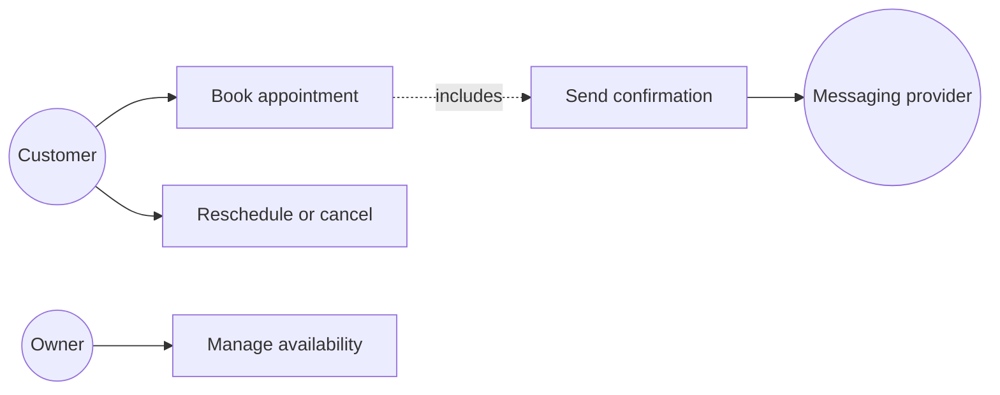

# Use Cases: [Product Name]

<strong>About this template</strong> (delete this block in your copy)

| | |
|---|---|
| **Purpose** | Describes complete interactions between an actor and the system to achieve a goal, including alternative and failure paths. Useful where workflows are complex, have several actors, or carry compliance or safety implications. |
| **When to use** | For multi-step or multi-actor workflows, and in enterprise or regulated contexts. For simple products, user stories with acceptance criteria are enough; skip this document. |
| **Owner** | Business Analyst or Product Manager. |
| **Required inputs** | [PRD](prd.md) requirements; [Persona](../01-discovery/persona.md); [Business Rules](business-rules.md). |
| **Related documents** | [User Stories](user-stories.md) · [User Flow](../04-ux-ui/user-flow.md) · [Test Scenarios](../07-quality/test-scenarios.md) |

> **Guidance:** Do not duplicate stories. A use case describes the **end-to-end flow** (the whole conversation); stories slice it into deliverable increments. Write steps as actor/system alternation in plain language, with no screen or technology detail.

## 1. Actors and Use Case Index

| ID | Use case | Primary actor | Goal | Requirements | Priority |
|---|---|---|---|---|---|
| UC-001 | Book an appointment | Customer (PER-01) | Reserve a slot | FR-001 | Must |
| UC-002 | Reschedule or cancel | Customer | Change plans without calling | FR-004 | Should |

## 2. Use Case Detail

### UC-001 — Book an appointment

| | |
|---|---|
| **Primary actor** | Customer |
| **Supporting actors / systems** | Messaging provider |
| **Goal** | Customer holds a confirmed slot for a chosen service |
| **Trigger** | Customer opens the business's booking page |
| **Preconditions** | Business has published at least one service and open slots |
| **Postconditions (success)** | Booking exists; slot is no longer offered; confirmation queued |
| **Postconditions (failure)** | No booking created; no slot held |
| **Business rules** | BR-001, BR-002 |

**Main flow**
1. Customer selects a service.
2. System shows available slots.
3. Customer selects a slot and enters name and phone number.
4. System validates the details and reserves the slot.
5. System shows a confirmation and queues a confirmation message.

**Alternative flows**
- **3a. No suitable slot:** Customer chooses another day; return to step 2.
- **4a. Slot taken meanwhile:** System informs the customer and offers alternatives; return to step 2.
- **4b. Invalid phone number:** System shows an error; return to step 3.

**Exceptions**
- **5a. Messaging provider unavailable:** Booking stays confirmed; system retries the message (NFR-004).

**Frequency / volume:** [e.g. up to 30 per minute at peak] · **Open questions:** [Q-xx]
**Related:** US-001–US-004 · [User Flow] · TS-001, TS-002

## 3. Use Case Diagram (optional)

## Completion Criteria

- [ ] Each use case has an actor, goal, trigger, pre/postconditions and a main flow.
- [ ] Alternative and exception flows cover the realistic failure paths.
- [ ] Business rules and requirements are referenced by ID.
- [ ] Every use case maps to stories and test scenarios.
- [ ] No technology or screen detail is embedded in the steps.
