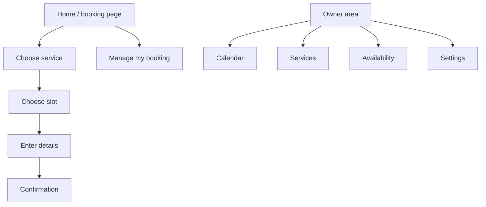

# Information Architecture and Sitemap: [Product Name]

<strong>About this template</strong> (delete this block in your copy)

| | |
|---|---|
| **Purpose** | Defines how content and functionality are organized, labelled and navigated, so users can find what they need and the team shares one structure. The sitemap is the structural view and is included here; there is no separate sitemap file. |
| **When to use** | After the PRD requirements and personas; before user flows and wireframes. Applies to apps, sites, admin consoles and developer portals. For API-only products, apply it to the documentation structure. |
| **Owner** | UX Designer or Information Architect. |
| **Required inputs** | [PRD](../03-requirements/prd.md) requirements; [Persona](../01-discovery/persona.md); content inventory; research on how users label and group things ([User Research](../01-discovery/user-research.md)). |
| **Related documents** | [User Flow](user-flow.md) · [Wireframe Spec](wireframe-spec.md) · [Design System](design-system.md) |

> **Guidance:** Organize around **user tasks and mental models**, not your internal org chart or database tables. Validate labels with users (card sorting, tree testing) when stakes are high. Keep navigation depth shallow; every important task should be reachable in few steps.

## 1. Content and Function Inventory

| ID | Item | Type (content / function) | Source requirement | Audience | Frequency of use |
|---|---|---|---|---|---|
| I-01 | Service list | Content | FR-001 | Customer | High |
| I-02 | Slot picker | Function | FR-001 | Customer | High |
| I-03 | Availability settings | Function | FR-005 | Owner | Medium |

## 2. Grouping and Labelling

| Group | Contains | Label users use | Label we use | Evidence |
|---|---|---|---|---|
| Booking | I-01, I-02 | "Book" | Book | Card sort, 8 participants |

**Labelling rules:** plain language, one term per concept (record in [Glossary](../00-foundation/glossary.md)), verbs for actions, nouns for places.

## 3. Sitemap

| Page / screen ID | Name | Parent | Audience | Requirement | Access |
|---|---|---|---|---|---|
| S-01 | Booking home | — | Public | FR-001 | Public |
| S-10 | Owner calendar | Owner area | Owner | FR-005 | Authenticated owner |

## 4. Navigation Model

| Element | Content | Behaviour | Notes |
|---|---|---|---|
| Primary navigation | | [Persistent / contextual] | |
| Secondary / local | | | |
| Utility (account, help) | | | |
| Search and filters | [Needed? scope] | | |
| Breadcrumbs / back behaviour | | | |

## 5. Naming, URLs and Deep Links (where relevant)

[URL structure principles, shareable links, redirects, behaviour for unknown routes.]

## 6. Validation

| Test | Result | Change made |
|---|---|---|
| Tree test: "Find where to change opening hours" | 7/10 succeeded | Renamed "Availability" |

## Completion Criteria

- [ ] Every in-scope FR maps to at least one screen or content item.
- [ ] Groupings and labels are based on user language and recorded in the glossary.
- [ ] Sitemap shows all screens with access level; no orphan pages.
- [ ] Core tasks are reachable within the agreed number of steps.
- [ ] Navigation model covers primary, secondary and utility navigation and error/empty routes.
