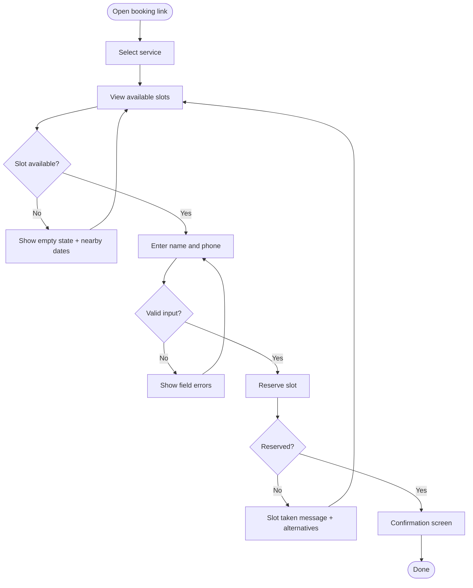

# User Flows: [Product Name]

<strong>About this template</strong> (delete this block in your copy)

| | |
|---|---|
| **Purpose** | Shows how a user moves through the product to reach a goal, including decisions, errors and exits, so that gaps are found before screens are designed. |
| **When to use** | After the sitemap and key scenarios are known; before wireframes. Create one flow per important task. |
| **Owner** | UX Designer. |
| **Required inputs** | [PRD](../03-requirements/prd.md) key scenarios; [Information Architecture](information-architecture.md); [Persona](../01-discovery/persona.md); [Use Cases](../03-requirements/use-cases.md) if they exist. |
| **Related documents** | [Wireframe Spec](wireframe-spec.md) · [User Stories](../03-requirements/user-stories.md) · [Event Tracking Plan](../10-analytics/event-tracking-plan.md) |

> **Guidance:** A flow shows **user decisions and system responses**, not implementation. Always draw the unhappy paths: errors, empty states, cancellation, and abandonment. Use Mermaid so diagrams are versioned alongside the text. Keep each diagram to about 15 nodes; split larger flows.

## 1. Flow Index

| ID | Flow | Persona | Goal | Entry point | Requirements | Priority |
|---|---|---|---|---|---|---|
| UF-01 | Customer books a slot | PER-01 | Confirmed booking | Shared link | FR-001 | Must |
| UF-02 | Owner sets availability | PER-02 | Slots published | Owner area | FR-005 | Must |

## 2. Flow Detail

### UF-01 — Customer books a slot

**Trigger and context:** [Customer taps a link in a chat message on a phone.]
**Success state:** [Confirmation shown, message queued.] **Primary failure states:** [Slot taken, invalid input, network loss.]

| Step | Screen / state | User action | System response | Error / alternative | Event |
|---|---|---|---|---|---|
| 1 | S-01 Booking home | Select service | Show slots | No slots → empty state | EVT-001 |
| 3 | S-03 Details | Submit | Validate; reserve | Invalid → inline error | EVT-002 |

**Edge cases:** [Back button mid-flow; session timeout; two tabs; slow connection; accessibility paths (keyboard only).]

## 3. Cross-Flow Concerns

| Concern | Decision |
|---|---|
| Authentication moments | [Where sign-in is needed, and how users return to their task] |
| Error recovery pattern | [Consistent approach] |
| Empty, loading, offline states | [Patterns; see [Design System](design-system.md)] |
| Notifications and re-entry | [How users return after reminders] |

## 4. Coverage Check

| Requirement | Has a flow? | Has error paths? | Notes |
|---|---|---|---|
| FR-001 | Yes | Yes | |
| FR-004 | **No** | | Add UF-03 |

## Completion Criteria

- [ ] Each *Must* FR with user interaction is covered by a flow.
- [ ] Every flow shows entry, success, and at least one failure path.
- [ ] Decisions and system responses are explicit and match business rules.
- [ ] Steps reference screen IDs and tracked events where measurement is needed.
- [ ] Edge cases (interruptions, errors, accessibility) are considered.
