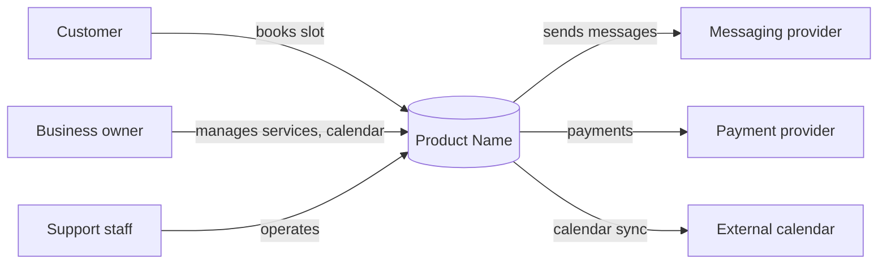
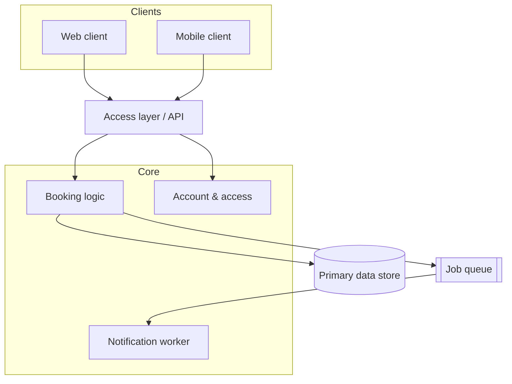
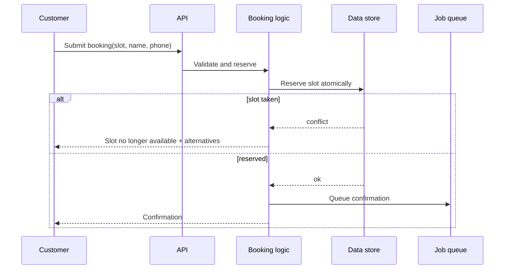

# Architecture Overview: [Product Name]

<strong>About this template</strong> (delete this block in your copy)

| | |
|---|---|
| **Purpose** | The shared mental model of the system: what it is made of, how the parts interact, which external systems it touches, and which decisions shape it. It also contains the **system context** view; there is no separate context document. Detail lives in the linked design documents. |
| **When to use** | After the PRD and NFRs are stable enough to constrain design; before detailed design and test planning. Keep it current: it is the first document a new engineer reads. |
| **Owner** | Engineering Lead (solo projects: the developer). |
| **Required inputs** | [PRD](../03-requirements/prd.md) scope and constraints; [NFRs](../03-requirements/non-functional-requirements.md); integration needs; team skills and operating constraints. |
| **Related documents** | [ADR](adr.md) · [Data Model](data-model.md) · [API Specification](api-specification.md) · [Integration Specification](integration-specification.md) · [Authentication & Authorization](authentication-authorization.md) · [Infrastructure & Scalability](infrastructure-and-scalability.md) · [Threat Model](../08-security/threat-model.md) |

> **Guidance:** Describe the architecture **at the level of responsibilities and boundaries**, not technologies, unless a technology is a hard constraint or a recorded decision. Every significant choice links to an ADR. If a reader cannot tell *why* the structure looks the way it does, add the missing rationale. Keep to roughly 3–6 pages; use diagrams to reduce text.

## 1. Purpose and Scope

[What system this describes, what is inside the boundary and what is outside. One paragraph.]

## 2. Architectural Drivers

> **Guidance:** The few requirements and constraints that most influence the design. Choose from the PRD and NFR documents, and reference IDs. If a driver does not change the design, it is not a driver.

| Driver | Source | Why it shapes the design |
|---|---|---|
| Customers book without registering | FR-001 | Public, unauthenticated entry point with abuse protection |
| Booking must never double-book | BR-002 | Needs a strongly consistent reservation operation |
| p95 booking API ≤ 400 ms at peak | NFR-002 | Keeps the booking path lightweight; defer heavy work asynchronously |
| Small team, limited operations capacity | CON-01 | Prefer managed services and fewer moving parts |

## 3. System Context

> **Guidance:** Show the system as a single box, the people who use it and the external systems it depends on or serves. No internals.

| External party | Interaction | Direction | Spec |
|---|---|---|---|
| Messaging provider | Send confirmations/reminders | Outbound | [Integration Specification](integration-specification.md) |

## 4. Solution Structure

> **Guidance:** Show the major building blocks (e.g. client applications, services, data stores, background workers) and how they talk. Use the same names everywhere. One diagram, then a table of responsibilities.

| Building block | Responsibility | Owns data | Key interfaces | Related NFRs |
|---|---|---|---|---|
| Booking logic | Availability, reservation, cancellation | Bookings, slots | API; job queue | NFR-002 |
| Notification worker | Deliver messages reliably | Delivery log | Messaging provider | NFR-004 |

## 5. Key Flows

> **Guidance:** Illustrate 2–4 flows that exercise the architecture: the main user journey, the most critical or risky operation, and a failure path.

## 6. Data Overview

[Main data categories, where each is stored, who owns it, and classification (public / internal / confidential / restricted). Entities and relationships are in [Data Model](data-model.md); classification rules in [Data Classification](../08-security/data-classification.md).]

## 7. Cross-Cutting Concerns

| Concern | Approach (summary) | Detail |
|---|---|---|
| Authentication and authorization | | [Authentication & Authorization](authentication-authorization.md) |
| Security | | [Security Requirements](../08-security/security-requirements.md) |
| Observability | | [Observability Strategy](../09-release-ops/observability-strategy.md) |
| Error handling and resilience | Retries, timeouts, idempotency, degradation | |
| Configuration and secrets | | |
| Scalability | | [Infrastructure & Scalability](infrastructure-and-scalability.md) |
| Deployment and environments | | [Deployment Plan](../09-release-ops/deployment-plan.md) |

## 8. Key Decisions

| ADR | Decision | Status |
|---|---|---|
| ADR-0001 | [e.g. Use a single deployable unit initially (modular monolith)] | Accepted |
| ADR-0002 | [e.g. Process notifications asynchronously via a job queue] | Accepted |

Technology choices are recorded in [Technology Stack](technology-stack.md) and as ADRs. This overview stays technology-agnostic where it can.

## 9. Constraints, Risks and Open Issues

| ID | Item | Type | Owner | Next step |
|---|---|---|---|---|
| RISK-0x | [e.g. Reliance on a single messaging provider] | Risk | [Name] | [Evaluate fallback] |

## 10. Requirement Coverage

| NFR / driver | Addressed by (building block, ADR) | Verified by |
|---|---|---|
| NFR-002 | Booking logic, ADR-0002 | TS-0xx (load test) |

## Completion Criteria

- [ ] System boundary and all external actors/systems are shown.
- [ ] Building blocks have clear, non-overlapping responsibilities and data ownership.
- [ ] Each architectural driver traces to a requirement ID and to a design response.
- [ ] Significant decisions are linked to ADRs; no unexplained technology choices.
- [ ] Every *Must* NFR is addressed by the design or flagged as a risk.
- [ ] Security, observability, resilience and deployment concerns are at least summarized.
- [ ] A new team member can explain the system after reading it once.
