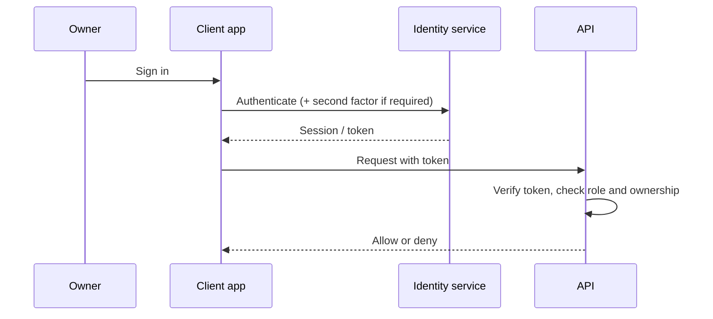

# Authentication and Authorization Design: [Product Name]

<strong>About this template</strong> (delete this block in your copy)

| | |
|---|---|
| **Purpose** | Defines how the system establishes *who* a user or client is (authentication) and *what* they may do (authorization), including sessions, credentials, roles and enforcement points. The *who-can-do-what* table itself lives in the [Access Control Matrix](../08-security/access-control-matrix.md); this document covers the mechanisms. |
| **When to use** | Whenever the product has accounts, roles, protected data or protected APIs. Skip only for fully public, read-only products. |
| **Owner** | Security Lead or Engineering Lead. |
| **Required inputs** | [Security Requirements](../08-security/security-requirements.md); [Architecture Overview](architecture-overview.md); [Persona](../01-discovery/persona.md) roles; regulatory needs. |
| **Related documents** | [Access Control Matrix](../08-security/access-control-matrix.md) · [API Specification](api-specification.md) · [Threat Model](../08-security/threat-model.md) · [Consumer Authentication](../../packages/api-platform/consumer-authentication.md) (API platforms) |

> **Guidance:** Prefer **established standards and proven services** over custom mechanisms; choose them in an ADR and cite the standard by name and version. Design for the worst day: stolen credentials, lost devices, leaked tokens, insider misuse. Do not invent cryptography. Have the design reviewed by someone with security expertise.

## 1. Actors and Identity Types

| Actor | Type (human / service / device) | Identity source | Notes |
|---|---|---|---|
| Customer (guest) | Human, unauthenticated | None; limited capability token for managing a booking | Abuse protection required |
| Business owner | Human | Own account | |
| Support agent | Human, internal | Corporate identity | Audited access |
| Partner system | Service | Client credentials | See API platform package |

## 2. Authentication

| Topic | Decision |
|---|---|
| Methods supported | [Password, passwordless link/code, social/enterprise single sign-on, API key, mutual trust between services] |
| Credential policy | [Strength, breach checks, lockout, throttling] |
| Multi-factor | [Who, when, which factors] |
| Account lifecycle | [Registration, verification, recovery, deactivation, deletion] |
| Session management | [Lifetime, renewal, revocation, device list, secure transport] |
| Service-to-service | [Method; rotation] |
| Secrets management | [Where stored; who has access; rotation schedule] |

## 3. Authorization Model

| Topic | Decision |
|---|---|
| Model | ☐ Role-based ☐ Attribute-based ☐ Relationship/ownership-based ☐ Combination |
| Roles and permissions | [Summary; full table in [Access Control Matrix](../08-security/access-control-matrix.md)] |
| Tenant / data boundary rules | [e.g. a user can only access records of their own business] |
| Enforcement points | [Where checks happen: edge, service, data layer; default deny] |
| Delegation and impersonation | [Support access: approval, audit, time limit] |
| Privileged operations | [Extra checks] |

## 4. Flows

[Add flows for registration, recovery, token renewal, revocation, and support access.]

## 5. Auditing and Monitoring

[Authentication and authorization events to log (success/failure, privilege changes), retention, alert rules; see [Observability Strategy](../09-release-ops/observability-strategy.md).]

## 6. Threats and Mitigations

| Threat | Mitigation | Verified by |
|---|---|---|
| Credential stuffing | Throttling, breach checks, MFA | Security test |
| Privilege escalation / insecure direct access | Ownership checks on every request | TS-0xx |
| Token theft | Short lifetime, revocation, secure storage | |

## 7. Open Decisions

| ID | Decision | Owner | ADR |
|---|---|---|---|

## Completion Criteria

- [ ] Every actor and identity type is identified, including services and support staff.
- [ ] Authentication, session, recovery and secrets handling are defined.
- [ ] Authorization model, enforcement points and default-deny behaviour are stated.
- [ ] Tenant or ownership isolation is explicit.
- [ ] Auditing and key threat mitigations are covered, and a qualified reviewer has checked the design.
- [ ] Choices are recorded as ADRs and cite named standards and versions.
