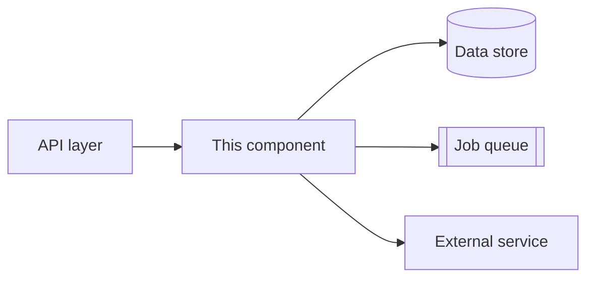

# Component Design: [Component Name]

<strong>About this template</strong> (delete this block in your copy)

| | |
|---|---|
| **Purpose** | Describes the internal design of one significant component: its responsibility, interfaces, data, behaviour, failure handling and quality characteristics, in enough detail for another engineer to build and test it. |
| **When to use** | For components that are complex, risky, shared across teams or hard to change. Skip for simple components that the architecture overview already explains. One copy per component. |
| **Owner** | The engineer or lead responsible for the component. |
| **Required inputs** | [Architecture Overview](architecture-overview.md) building-block entry; relevant [ADRs](adr.md); [NFRs](../03-requirements/non-functional-requirements.md). |
| **Related documents** | [Data Model](data-model.md) · [API Specification](api-specification.md) · [Integration Specification](integration-specification.md) |

> **Guidance:** Describe *what and why* at the design level; leave code-level detail to the code. Use the same component names as the architecture overview. Prefer diagrams and tables to prose.

## 1. Purpose and Responsibilities

| | |
|---|---|
| **Component** | [Name as in Architecture Overview] |
| **Responsibility** | [One sentence] |
| **Owns** | [Data and decisions it is solely responsible for] |
| **Does not do** | [Explicit non-responsibilities] |
| **Requirements served** | [FR-001, BR-002, NFR-002] |

## 2. Context and Dependencies

| Dependency | Direction | Purpose | Failure impact |
|---|---|---|---|

## 3. Interfaces

| Interface | Type (sync call / event / job) | Contract (summary) | Consumer | Reference |
|---|---|---|---|---|
| Reserve slot | Sync | Input slot id, customer; output booking or conflict | API layer | [API Specification](api-specification.md) |

## 4. Internal Structure and Behaviour

[Key internal parts and their roles; algorithm or rule descriptions; state machines; concurrency and consistency approach. Include a sequence or state diagram for the critical behaviour.]

## 5. Data

[Entities owned, access patterns, consistency needs; reference [Data Model](data-model.md).]

## 6. Error Handling, Resilience and Idempotency

| Failure | Detection | Behaviour | Recovery |
|---|---|---|---|
| Duplicate request | Idempotency key | Return original result | None needed |
| Dependency timeout | Timeout/circuit rule | Degrade / retry with backoff | Alert if > threshold |

## 7. Quality Attributes

| NFR | How this component meets it | How to verify |
|---|---|---|

## 8. Security and Privacy

[Data handled and classification, access control, input validation, secrets, audit events; see [Threat Model](../08-security/threat-model.md).]

## 9. Observability

[Key logs, metrics and traces; alerts (MON- IDs).]

## 10. Testing Approach

[Unit, integration and contract test emphasis; how to simulate failures; scenario IDs.]

## 11. Open Issues

| ID | Issue | Owner | Due |
|---|---|---|---|

## Completion Criteria

- [ ] Responsibilities and non-responsibilities are clear and consistent with the architecture overview.
- [ ] Interfaces, dependencies and failure behaviour are documented.
- [ ] Each quality requirement the component affects is addressed and verifiable.
- [ ] Security, observability and testing considerations are included.
- [ ] Peers could implement and test it from this document.
