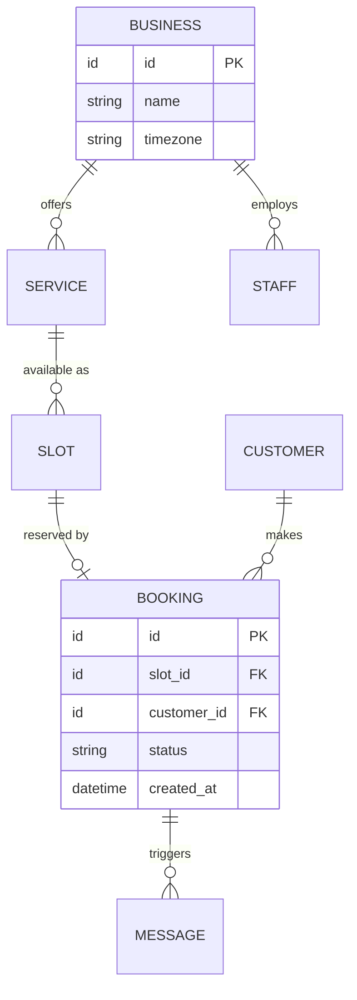

# Data Model: [Product Name]

<strong>About this template</strong> (delete this block in your copy)

| | |
|---|---|
| **Purpose** | Describes the data the product keeps: the entities and relationships (ERD), the meaning and rules of every field (data dictionary), and how data is stored, retained and protected. One document replaces separate "Database Design", "ERD" and "Data Dictionary" files. |
| **When to use** | After business rules and the architecture overview; before API design and implementation. Update on every schema-affecting change. |
| **Owner** | Engineering Lead (with a data engineer or DBA where available). |
| **Required inputs** | [Business Rules](../03-requirements/business-rules.md); [PRD](../03-requirements/prd.md); [Architecture Overview](architecture-overview.md); data protection requirements. |
| **Related documents** | [API Specification](api-specification.md) · [Data Classification](../08-security/data-classification.md) · [Privacy Requirements](../08-security/privacy-requirements.md) · [Backup & Recovery](../09-release-ops/backup-and-recovery.md) |

> **Guidance:** Start with the **conceptual model** (entities and relationships in business language), then add detail. The model is technology-agnostic: record the storage technology in the [Technology Stack](technology-stack.md). Keep names consistent with the [Glossary](../00-foundation/glossary.md). Every field that holds personal or sensitive data must have a classification.

## 1. Conceptual Model (ERD)

| Entity | Definition (business language) | Owner / source of truth | Lifecycle |
|---|---|---|---|
| Booking | A customer's reservation of one slot | Booking component | Requested → Confirmed → Completed / Cancelled |

## 2. Relationships and Constraints

| Relationship | Cardinality | Rule | Business rule ID |
|---|---|---|---|
| Slot → Booking | 1 : 0..1 | A slot has at most one active booking | BR-002 |

## 3. Data Dictionary

| Entity | Field | Type (logical) | Required | Constraints / allowed values | Description | Classification | PII? | Source / rule |
|---|---|---|---|---|---|---|---|---|
| Booking | id | Identifier | Yes | Unique, immutable | System-generated id | Internal | No | |
| Booking | status | Enumeration | Yes | requested, confirmed, cancelled, completed, no_show | Current state | Internal | No | BR-002 state rules |
| Customer | phone | Text | Yes | Valid format | Contact number for messages | Confidential | **Yes** | Consent required |

Use logical types (text, integer, decimal, boolean, date, datetime, identifier, enumeration); map to physical types during implementation.

## 4. Physical Design Notes (when the store is chosen)

| Topic | Decision |
|---|---|
| Storage technology and rationale | [Link ADR] |
| Keys and indexes (based on query patterns) | |
| Partitioning / tenancy approach | |
| Naming conventions | |
| Migration and versioning approach | [How schema changes roll out and roll back] |

## 5. Data Lifecycle

| Data set | Retention | Archival / deletion | Backup | Legal or policy basis |
|---|---|---|---|---|
| Bookings | [Duration] | [Rule] | [Frequency; see Backup & Recovery] | [Source verified by] |

## 6. Data Quality and Integrity

[Validation rules, referential integrity, deduplication, reconciliation with external systems, audit trail requirements.]

## 7. Reference and Seed Data

[Static lists, defaults, test fixtures; ownership and update process.]

## Completion Criteria

- [ ] Every entity in the PRD, business rules and API appears in the ERD, and vice versa.
- [ ] Relationships and cardinalities reflect business rules, referenced by ID.
- [ ] Every field has a definition, constraint, classification and PII flag.
- [ ] Retention, deletion and backup are defined for each data set.
- [ ] Migration approach is described; no technology detail contradicts the Technology Stack.
- [ ] Terms match the glossary.
