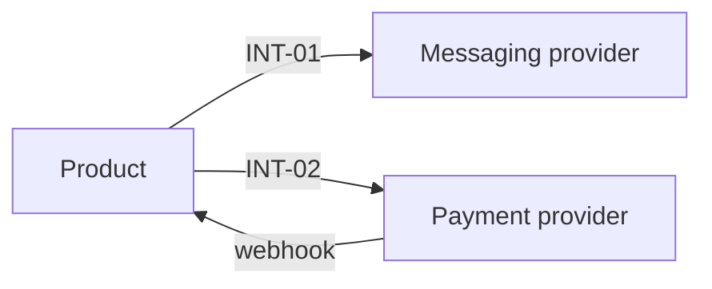

# Integration Specification: [Product Name]

<strong>About this template</strong> (delivered as one document, one section per integration)

| | |
|---|---|
| **Purpose** | Specifies every connection to an external system or service: what is exchanged, how, how often, how failures are handled, and who owns it. Optional for products with no external dependencies; *recommended* once there is more than one integration or any integration is business-critical. |
| **When to use** | When an external system appears in the architecture overview's system context. Update when a vendor changes terms or interfaces. |
| **Owner** | Engineering Lead. |
| **Required inputs** | [Architecture Overview](architecture-overview.md) system context; vendor documentation and terms; [NFRs](../03-requirements/non-functional-requirements.md). |
| **Related documents** | [API Specification](api-specification.md) · [Risk Register](../06-project-mgmt/risk-register.md) · [Enterprise Integration](../../packages/enterprise/enterprise-integration.md) (SSO, directory, ERP specifics) |

> **Guidance:** Treat every integration as a **risk and a dependency**: record who owns it, what happens when it fails, and how to replace it. Never store credentials in documents: reference where secrets are managed. Verify rate limits, pricing and terms against the vendor's current published documentation, and record the date checked.

## 1. Integration Register

| ID | System | Purpose | Direction | Pattern | Criticality | Owner (ours / vendor) | Status |
|---|---|---|---|---|---|---|---|
| INT-01 | Messaging provider | Send confirmations | Outbound | API call + delivery webhooks | High (MET-01) | Eng / [Vendor contact] | Planned |
| INT-02 | Payment provider | Take deposits | Outbound + inbound | API + webhooks | Medium (R2) | | Planned |

Pattern options: request/response API · event/webhook · batch file transfer · message queue · database link · embedded SDK · manual process.

## 2. Integration Detail (repeat per integration)

### INT-01 — [System]

| Aspect | Specification |
|---|---|
| Business purpose and requirement | FR-002; MET-01 |
| Data exchanged | [Fields; classification; whether personal data leaves our boundary] |
| Interface and protocol | [Vendor documentation reference, version, date checked] |
| Authentication | [Method; where secrets are managed; rotation] |
| Volume and frequency | [Per day / peak per minute] |
| Limits and quotas | [Vendor rate limits and our budget] |
| Latency and availability expectations | [Vendor SLA vs our NFRs] |
| Error handling | [Retry with backoff; idempotency; dead-letter handling; manual recovery] |
| Failure impact and fallback | [What users see; degraded mode] |
| Data mapping | [Source field → target field; transformations; unit/time-zone rules] |
| Security and privacy | [Contractual data processing terms; data residency; consent; see [Privacy Requirements](../08-security/privacy-requirements.md)] |
| Testing | [Sandbox; contract tests; failure simulation] |
| Monitoring | [Delivery success metric; alerts MON-xx] |
| Cost | [Unit price; expected monthly cost] |
| Exit plan | [How to replace the vendor; data export] |

## 3. Dependency Map

## 4. Change and Vendor Management

| Item | Plan |
|---|---|
| Notification of vendor changes | [Subscribe to changelogs; owner] |
| Version upgrades | |
| Contract / SLA review date | |

## Completion Criteria

- [ ] Every external system in the architecture overview appears in the register.
- [ ] Data exchanged is classified, and personal-data flows are identified.
- [ ] Each integration has failure handling, a fallback and monitoring.
- [ ] Limits, costs and vendor SLA are compared with NFRs and budget.
- [ ] Ownership, secrets handling and an exit plan are defined.
