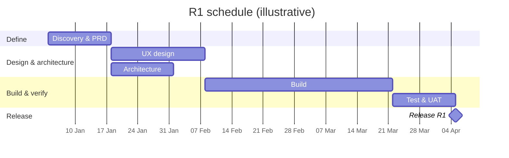

# Milestone Plan: [Project Name]

<strong>About this template</strong> (delete this block in your copy)

| | |
|---|---|
| **Purpose** | The dated project schedule: the major checkpoints, what must be true at each, who owns them and how they depend on each other. It is the **project-level** counterpart to the outcome-oriented [Roadmap](../02-strategy/roadmap.md). |
| **When to use** | After the charter and first estimates; review at least every two weeks. |
| **Owner** | Project Manager. |
| **Required inputs** | [Project Charter](project-charter.md); [Roadmap](../02-strategy/roadmap.md); [WBS](wbs.md) estimates if available; team capacity. |
| **Related documents** | [Release Plan](../09-release-ops/release-plan.md) · [Sprint Planning](sprint-planning.md) · [Risk Register](risk-register.md) |

> **Guidance:** A milestone is a **verifiable state**, not a period of work: "Design approved", not "Design phase". Define each with **exit criteria** so progress cannot be declared by feeling. Show the critical path and add buffer deliberately rather than hiding it in estimates.

## 1. Milestones

| ID | Milestone | Exit criteria (evidence) | Target date | Owner | Depends on | Status |
|---|---|---|---|---|---|---|
| M1 | Discovery complete | Brief, Goals, PRD approved | [Date] | PM | — | Not started |
| M2 | Design freeze (R1) | Wireframe spec reviewed; PR- findings resolved | [Date] | Designer | M1 | |
| M3 | Architecture baselined | Architecture overview, key ADRs, data model, API spec approved | [Date] | Eng Lead | M1 | |
| M4 | Feature complete (R1) | All Must stories done; no open Critical defects | [Date] | Eng Lead | M2, M3 | |
| M5 | Release candidate | Test Strategy gates met; UAT passed | [Date] | QA | M4 | |
| M6 | Release R1 | Go/no-go passed; deployed | [Date] | PM | M5 | |
| M7 | Post-launch review | Week-12 metrics reviewed | [Date] | PM | M6 | |

*(Milestone IDs here are local to this plan, to avoid clashing with the `MET-` metric IDs; they are not a traceability prefix.)*

## 2. Timeline

## 3. Critical Path and Buffer

| Item | Detail |
|---|---|
| Critical path | [Chain of milestones with no slack] |
| Buffer | [Amount, where held, who may spend it] |
| Fixed dates and external dependencies | [Events, approvals, vendor deliveries; DEP- IDs] |

## 4. Progress Tracking

| Milestone | Baseline date | Forecast | Variance | Notes / recovery action |
|---|---|---|---|---|

**Review rule:** if a milestone forecast slips by more than [threshold], raise it at the next review and log a decision (re-scope, add time, add capacity).

## 5. Dependencies and Risks

[Link RISK- and DEP- IDs that threaten milestone dates.]

## Completion Criteria

- [ ] Each milestone has verifiable exit criteria, an owner and a date.
- [ ] Dates are consistent with the Roadmap, Release Plan and Charter constraints.
- [ ] Critical path, buffer and external dependencies are explicit.
- [ ] Baseline is saved and a review cadence is set.
