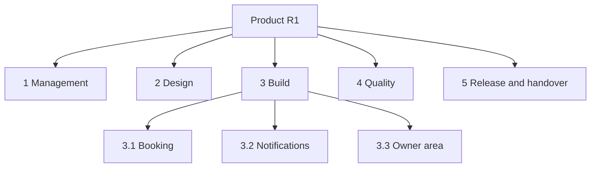

# Work Breakdown Structure: [Project Name]

<strong>About this template</strong> (delete this block in your copy)

| | |
|---|---|
| **Purpose** | Decomposes the project deliverables into manageable work packages so nothing is forgotten, effort can be estimated and ownership is clear. It is organized by **deliverable**, not by calendar time. |
| **When to use** | For larger or multi-team projects, fixed-scope or fixed-price work, or when estimates are needed before sprint planning. Small agile teams can rely on the backlog and skip this. |
| **Owner** | Project Manager, with the team. |
| **Required inputs** | [Project Charter](project-charter.md) scope; [PRD](../03-requirements/prd.md) requirements; [Architecture Overview](../05-architecture/architecture-overview.md). |
| **Related documents** | [Milestone Plan](milestone-plan.md) · [Resource Plan](resource-plan.md) · [Sprint Planning](sprint-planning.md) |

> **Guidance:** Follow the **100% rule**: the WBS must include all work needed for the scope, and nothing outside it. Decompose until a work package can be estimated and assigned to one owner (typically 1–10 working days). Use nouns (deliverables), not verbs. Include non-feature work: planning, design, documentation, testing, release, handover.

## 1. WBS Outline

| WBS ID | Work package (deliverable) | Linked requirement | Owner | Estimate (days) | Basis of estimate | Depends on |
|---|---|---|---|---|---|---|
| 1.1 | Project plan and charter | — | PM | 2 | Experience | — |
| 2.1 | Booking flow wireframes | FR-001 | Designer | 4 | Similar work | 1.1 |
| 3.1.1 | Slot availability logic | FR-001 | Dev | 8 | Spike | 2.1 |
| 4.1 | Test scenarios for FR-001 | FR-001 | QA | 3 | | 3.1.1 |

## 2. Work Package Definitions (for key packages)

| WBS ID | Description | Deliverables | Acceptance criteria | Assumptions | Risks |
|---|---|---|---|---|---|

## 3. Estimation Summary

| Level | Total effort | Contingency | Confidence |
|---|---|---|---|

Record the estimation method (analogy, three-point, bottom-up) and the contingency rationale. Estimates are ranges, not promises.

## 4. Coverage Check

| Requirement | WBS packages | Complete? |
|---|---|---|
| FR-001 | 2.1, 3.1.x, 4.1 | Yes |

## Completion Criteria

- [ ] Every in-scope FR and every project-level activity is covered by at least one work package.
- [ ] Work packages are deliverable-oriented, owned and estimated.
- [ ] Dependencies are listed; no work outside the charter scope is included.
- [ ] Estimates state method, uncertainty and contingency.
