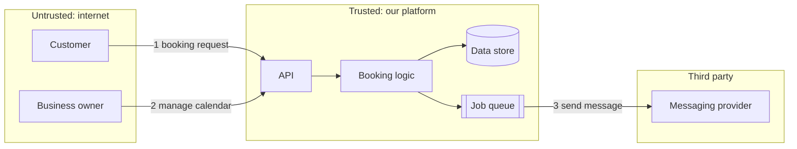

# Threat Model: [Product Name]

<strong>About this template</strong> (delete this block in your copy)

| | |
|---|---|
| **Purpose** | Systematically identifies what could go wrong with the design from a security viewpoint, decides what to do about each threat, and feeds the results into requirements, tests and the risk register. Canonical home for `TH-` IDs. |
| **When to use** | After the architecture overview exists, while the design can still change cheaply. Repeat for significant changes (new integration, new data type, new trust boundary). |
| **Owner** | Security Lead (solo projects: the developer, with an external review if the data is sensitive). |
| **Required inputs** | [Architecture Overview](../05-architecture/architecture-overview.md) context and structure diagrams; [Data Classification](data-classification.md); [Authentication & Authorization](../05-architecture/authentication-authorization.md). |
| **Related documents** | [Security Requirements](security-requirements.md) · [Security Test Plan](../07-quality/security-test-plan.md) · [Risk Register](../06-project-mgmt/risk-register.md) |

> **Guidance:** The method below is **STRIDE**, a commonly used way to prompt for threats (Spoofing, Tampering, Repudiation, Information disclosure, Denial of service, Elevation of privilege). It is an example, not a requirement: any structured method (attack trees, abuse cases, a lightweight "what can go wrong?" workshop) is acceptable if you record assets, boundaries, threats and decisions. Model the **design**, not the tools. Involve engineers who know the system. A threat model is a living document, not an audit artefact.

## 1. Scope and Assumptions

| | |
|---|---|
| **System / feature in scope** | |
| **Out of scope** | |
| **Assumptions** (e.g. the hosting provider secures the physical layer) | ASM-xx |
| **Version of design analysed** | [Architecture Overview version] |
| **Participants and date** | |

## 2. Assets

| Asset | Why it matters | Classification | Owner |
|---|---|---|---|
| Customer contact details | Privacy harm; legal exposure | Confidential | Product |
| Booking records | Integrity of the business's calendar | Internal | Product |
| Credentials and tokens | Gate to all data | Restricted | Engineering |
| Availability of booking | Revenue; MET-01 | — | Engineering |

## 3. Data Flow and Trust Boundaries

> **Guidance:** Show external actors, processes, data stores and data flows. Mark each **trust boundary**: a line where the level of trust changes (internet ↔ system, system ↔ third party, user ↔ admin). Threats cluster at boundaries.

| Flow | From → To | Data | Boundary crossed | Protection |
|---|---|---|---|---|
| 1 | Customer → API | Name, phone | Internet → platform | Encrypted transport; validation |
| 3 | Queue → Messaging provider | Phone, text | Platform → vendor | Encrypted transport; vendor terms |

## 4. Threat Catalog

| ID | Element / flow | Category | Threat (who does what, to get what) | Likelihood | Impact | Decision | Mitigation (SR- / design) | Residual risk | Status |
|---|---|---|---|---|---|---|---|---|---|
| TH-01 | Flow 1 | Spoofing | Attacker books slots using someone else's phone number to harass them | M | M | Mitigate | SR-006; verification code | Low | Open |
| TH-02 | API | Elevation of privilege | Caller modifies another business's calendar by guessing identifiers | M | H | Mitigate | SR-001, SR-002; non-guessable ids | Low | Open |
| TH-03 | Data store | Information disclosure | Query without tenant filter returns another business's customers | L | H | Mitigate | SR-002; automated tenant tests | Low | Open |
| TH-05 | Booking endpoint | Denial of service | Scripted requests exhaust all slots | H | M | Mitigate | SR-006 | Medium | Open |
| TH-06 | Support tooling | Repudiation | Staff view customer data with no trace | M | M | Mitigate | SR-007 | Low | Open |

**Category prompts:** *S* pretending to be someone else · *T* changing data or code without permission · *R* denying an action when no evidence exists · *I* exposing data to those not entitled · *D* making the service unavailable · *E* gaining capabilities not granted.
**Decision options:** Mitigate · Avoid (change the design) · Transfer · Accept (with owner and review date).

## 5. Residual Risk and Hand-offs

| Threat | Residual risk | Risk ID | Accepted by / date |
|---|---|---|---|
| TH-05 | Medium | RISK-xx | [Name, date] |

Hand-offs: new requirements go to [Security Requirements](security-requirements.md); test ideas to [Security Test Plan](../07-quality/security-test-plan.md); accepted or unresolved threats to the [Risk Register](../06-project-mgmt/risk-register.md).

## 6. Review Log

| Date | Trigger (new feature, incident, quarterly) | Changes | Reviewer |
|---|---|---|---|

## Completion Criteria

- [ ] Scope, assumptions and the design version analysed are stated.
- [ ] Assets are identified and classified; trust boundaries are drawn on a data-flow diagram.
- [ ] Every boundary-crossing flow was examined for each threat category (or the method's equivalent).
- [ ] Each threat has a decision, an owner, and a mitigation that traces to an `SR-` requirement or design change.
- [ ] Residual and accepted risks are in the Risk Register with owners.
- [ ] A review trigger or date is set.
