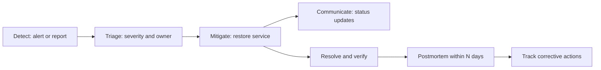

# Incident Management Plan: [Product Name]

<strong>About this template</strong> (delete this block in your copy)

| | |
|---|---|
| **Purpose** | Defines how the team detects, classifies, responds to, communicates about and learns from production incidents, so that service is restored quickly and the same failure is not repeated. |
| **When to use** | Before launch for any product with live users. Keep it short enough that people read it; a one-page version suffices for small teams. |
| **Owner** | Operations Lead (solo: the developer). |
| **Required inputs** | [Observability Strategy](observability-strategy.md) alerts; [NFRs](../03-requirements/non-functional-requirements.md) availability and recovery targets; contact lists. |
| **Related documents** | [Operational Readiness](operational-readiness.md) · [Backup & Recovery](backup-and-recovery.md) · [Maintenance Plan](maintenance-plan.md) · [Post-Launch Review](../10-analytics/post-launch-review.md) |

> **Guidance:** Prioritize **restoring service** over finding the root cause. Decide roles and communication **in advance**. Security incidents and personal-data breaches may carry **legal notification duties and deadlines**; identify the rules that apply to you with qualified advice, and add them in §6.

## 1. Definitions and Severity

| Severity | Definition (user impact) | Example | Response target | Update cadence |
|---|---|---|---|---|
| SEV1 | Core function unavailable or data at risk for many users | Bookings failing for all | Immediate; page on-call | Every 30 min |
| SEV2 | Major function degraded; workaround exists | Reminders delayed > 1 h | Within 30 min | Every 60 min |
| SEV3 | Minor impact | Cosmetic error on one page | Next business day | As needed |

*(Adjust response times to your staffing; state what is realistic.)*

## 2. Roles

| Role | Responsibility | Primary | Backup |
|---|---|---|---|
| Incident commander | Coordinates, decides, tracks timeline | | |
| Technical lead | Diagnoses and fixes | | |
| Communications lead | Updates customers and stakeholders | | |
| Scribe | Records timeline and actions | | |

## 3. Response Process

| Phase | Actions |
|---|---|
| Detect | Alerts (MON-), customer reports, monitoring of support channels |
| Triage | Assign severity and commander; open incident record |
| Mitigate | Rollback, disable feature, fail over, scale, block abuse; record each change |
| Communicate | Status page or message, internal updates, support briefing |
| Resolve | Confirm recovery through SLIs; close incident |
| Learn | Blameless postmortem for SEV1/SEV2 |

## 4. Communication

| Audience | Channel | Template message | Owner |
|---|---|---|---|
| Customers | [Status page / e-mail / in-app] | "We are investigating…; impact…; next update at…" | |
| Internal | [Chat channel] | | |
| Leadership | | | |

## 5. Postmortem Template (blameless)

| Section | Content |
|---|---|
| Summary | What happened, impact, duration |
| Timeline | Detection → resolution (UTC) |
| Impact | Users, data, revenue, SLO consumption |
| Root cause and contributing factors | Systems and process, not individuals |
| What went well / poorly / luck | |
| Corrective actions | Action, owner, due date, linked RISK-/ticket |

## 6. Security Incidents and Personal-Data Breaches

[Additional steps: containment, evidence preservation, assessment of affected data, **legal and contractual notification duties and deadlines (to be determined with qualified advice)**, regulator and customer notification owner.]

## 7. Contacts and Tools

[On-call schedule location, vendor support contacts, status page, runbook index. Keep contact details outside the public repository if sensitive.]

## Completion Criteria

- [ ] Severity levels are defined by user impact with realistic response targets.
- [ ] Roles and backups are assigned; on-call exists for SEV1.
- [ ] Communication paths and templates exist for customers and internal teams.
- [ ] A blameless postmortem process with tracked actions is defined.
- [ ] Security and personal-data incident handling and legal notification duties are identified.
- [ ] The plan was tested through a drill or tabletop exercise.
